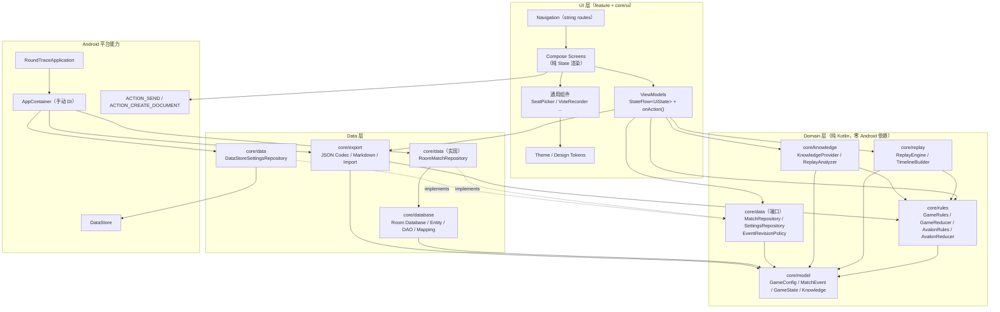

# RoundTrace（局迹）系统架构设计

> 版本 v1.0 · 2026-10-30
> 事实来源：《01_产品需求文档_PRD.md》《02_技术实施文档_TDD.md》《docs/DESIGN_SPEC.md》
> 本文档只描述**设计与契约**，不包含实现代码。任务拆解见 `docs/TASKS.md`。
> 语言：简体中文。代码标识符用英文。

---

## 0. 环境与版本基线评审结论

### 0.1 采纳的基线（主理人已定，我审阅后确认可用）

| 项 | 版本 | 我的结论 |
|---|---|---|
| AGP | `8.5.2` | 可用。**必须配 Gradle ≥ 8.7**，建议 pin `8.9`（wrapper）。AGP 8.5.2 + JDK17 toolchain 官方支持。 |
| Kotlin | `2.0.21` | 可用。**Compose 编译器必须改用 `org.jetbrains.kotlin.plugin.compose` 插件（同 2.0.21）**，不得再写 `composeOptions { kotlinCompilerExtensionVersion }`（Kotlin 2.0 起该字段已废弃，写错会直接编译失败）。 |
| KSP | `2.0.21-1.0.25` | 可用。该版本默认 `ksp.useKSP2=false`，与 Room 2.6.1 的 KSP1 处理器兼容。**不要**在 `gradle.properties` 里打开 `ksp.useKSP2=true`。 |
| Compose BOM | `2024.10.01` | 可用（ui 1.7.4 / material3 1.3.0），与 Kotlin 2.0.21 的 Compose 编译器匹配。 |
| compileSdk / targetSdk / minSdk | 34 / 34 / 26 | 可用。targetSdk 34 需要 `android:exported` 显式声明（Manifest 已按此写）。 |
| Java toolchain | 17 | 可用。`kotlin { jvmToolchain(17) }` + `compileOptions` 双写。 |
| Room | `2.6.1` | 可用。需 `ksp { arg("room.schemaLocation", "$projectDir/schemas") }`，`schemas/` 必须提交到仓库（迁移测试依赖它）。 |
| Navigation Compose | `2.8.4` | 可用。**使用传统字符串路由**，不用 type-safe serialization 路由，减少一条 Kotlin serialization 插件链路风险。 |
| DataStore | `1.1.1` | 可用。 |
| kotlinx-serialization-json | `1.7.3` | 可用（需 Kotlin ≥ 2.0.20）。**JSON 只用于 `payloadJson`、`configJson`、导出/导入**，不参与导航路由。 |
| Lifecycle / Activity / Core KTX | `2.8.7` / `1.9.3` / `1.13.1` | 可用。Collect Flow 用 `androidx.lifecycle:lifecycle-runtime-compose:2.8.7` 的 `collectAsStateWithLifecycle()`。 |

### 0.2 我需要提出的 4 条强制补充（不改变基线，只是补齐把基线跑通的必要项）

1. **Gradle Wrapper 固定 8.9**：AGP 8.5.2 不兼容 Gradle < 8.7。必须提交 `gradle/wrapper/gradle-wrapper.properties`（`distributionUrl=...gradle-8.9-bin.zip`）+ `gradle-wrapper.jar` + `gradlew` + `gradlew.bat`。若本机无 Gradle 无法生成 wrapper jar，用 `gradle wrapper --gradle-version 8.9` 生成一次后提交，**不要手写 jar**。
2. **Compose 编译插件**：`app/build.gradle.kts` 引入 `alias(libs.plugins.kotlin.compose)`（`org.jetbrains.kotlin.plugin.compose`），`libs.versions.toml` 中 `[plugins]` 增加该条目，版本与 Kotlin 一致。
3. **Room schema 与迁移测试**：`app/schemas/` 提交；`androidTestImplementation("androidx.room:room-testing:2.6.1")`。正式数据禁止 `fallbackToDestructiveMigration()`（TDD §8）。
4. **单测可跑性**：`testOptions { unitTests { isReturnDefaultValues = true } }`；`packaging { resources { excludes += "/META-INF/{AL2.0,LGPL2.1}" } }`（避免 Compose 测试重复 META-INF 报错）。

### 0.3 明确记录：本机当前无法验证构建

本机现状：无 JDK / Android SDK / Gradle（主理人后台安装中）。因此本文档中所有「构建通过」类结论**均为设计预期，不是实测**。验证命令（Windows Git Bash）：

```bash
./gradlew :app:assembleDebug          # 需 JDK17 + compileSdk 34
./gradlew :app:testDebugUnitTest      # 纯 JVM 领域测试，最高优先级
./gradlew :app:lintDebug
./gradlew :app:connectedDebugAndroidTest   # 需设备/模拟器；无设备时改人工清单
```

---

## 1. 分层架构与依赖方向

### 1.1 分层图



### 1.2 依赖方向硬约束（可被 review / grep 检查）

| 规则 | 内容 | 检查方式 |
|---|---|---|
| D1 | `core/model`、`core/rules`、`core/replay`、`core/knowledge`（不含 `core/data` 之外的实现）**禁止** import `android.*`、`androidx.compose.*`、`androidx.room.*`、`androidx.datastore.*` | `grep -rn "^import android" app/src/main/java/com/roundtrace/app/core/{model,rules,replay,knowledge}` 必须为空 |
| D2 | `feature/**` **禁止** import `core/database/**`（不得直接碰 DAO/Entity） | grep 检查 |
| D3 | `feature/**` **禁止** import `core/data/RoomMatchRepository`、`DataStoreSettingsRepository`（只能依赖端口接口） | grep 检查 |
| D4 | `core/database/**` **禁止** import `feature/**`、`core/ui/**` | grep 检查 |
| D5 | 任何 Composable **禁止**写 `Color(0xFF...)`；唯一例外是 `core/ui/theme/Color.kt` | grep 检查 DESIGN_SPEC §8 最后一条 |
| D6 | Domain 层返回的业务文案不直接拼 UI 字符串：`RuleIssue`/`EvidenceFinding` 携带 `code`/`ruleId`/参数，由 `core/ui/IssueText.kt` 映射为 `stringResource` | 人工 review |
| D7 | ViewModel 不持有 `Context`；需要 Context 的能力（分享、文件）通过 `core/export/ShareLauncher.kt`（Android 侧）注入函数式接口 | 人工 review |

### 1.3 运行时依赖装配（手动 DI）

```
RoundTraceApplication
  └─ val container: AppContainer            // lazy 单例
       ├─ database: RoundTraceDatabase      // Room
       ├─ gameRegistry: GameRulesRegistry   // 规则版本解析
       ├─ reducer: GameReducer              // AvalonReducer
       ├─ knowledgeProvider: KnowledgeProvider
       ├─ analyzer: ReplayAnalyzer
       ├─ matchRepository: MatchRepository  // RoomMatchRepository
       ├─ settingsRepository: SettingsRepository // DataStore
       ├─ importExport: ImportExportService
       └─ clocks/uuid: Clock, IdGenerator   // 可注入，便于测试
```

ViewModel 通过 `viewModelFactory { initializer { ... } }`（`androidx.lifecycle:lifecycle-viewmodel-compose`）在 Composable 侧构造，`AppContainer` 由 `LocalContext.current.applicationContext as RoundTraceApplication` 取得。

不引入 Hilt 的理由与代价见 §9.1。

---

## 2. 核心领域模型（字段级）

### 2.1 ID 与基础枚举

```kotlin
// core/model/Ids.kt
@JvmInline value class MatchId(val raw: String)      // UUID v4 字符串
@JvmInline value class EventId(val raw: String)      // UUID v4 字符串
typealias SeatId = Int                               // 1..10，非法值由规则层拒绝

// core/model/Enums.kt
enum class GameType { AVALON, WEREWOLF }             // WEREWOLF 仅占位，MVP 无实现

enum class RoleId(val alignment: Alignment) {
    MERLIN(Alignment.GOOD),
    PERCIVAL(Alignment.GOOD),
    LOYAL_SERVANT(Alignment.GOOD),
    MORGANA(Alignment.EVIL),
    ASSASSIN(Alignment.EVIL),
    MORDRED(Alignment.EVIL),
    MINION(Alignment.EVIL),
    OBERON(Alignment.EVIL),
    UNKNOWN(Alignment.UNKNOWN);
    companion object { fun fromPersisted(raw: String?): RoleId }
}

enum class Alignment { GOOD, EVIL, UNKNOWN }

/** 持久化到 matches.status。刻意不含 INCOMPLETE —— 见 §9.3 裁决 3。 */
enum class MatchStatus {
    DRAFT,                  // 已创建，尚无任何 QUEST_STARTED
    IN_PROGRESS,
    AWAITING_ASSASSINATION, // 三次任务成功、刺客未结算
    FINISHED_GOOD,
    FINISHED_EVIL,
    ABANDONED
}

/** reducer 内部推进阶段（不持久化，由状态推导） */
enum class RecordPhase {
    NOT_STARTED,        // 等待第 1 次 QUEST_STARTED
    PROPOSAL_OPEN,      // 等待/可编辑队伍提案
    VOTING,             // 已有提案，等待投票
    MISSION_PENDING,    // 提案已通过，等待任务牌
    QUEST_RESOLVED,     // 本任务已结算，等待下一次 QUEST_STARTED
    ASSASSINATION,
    ENDED
}

enum class IntegrityStatus { OK, NEEDS_REVIEW, INCOMPLETE }

enum class TeamVoteChoice { APPROVE, REJECT, UNKNOWN }
enum class ProposalDecision { APPROVED, REJECTED, UNKNOWN }
enum class MissionOutcome { SUCCESS, FAILED, UNKNOWN }

enum class WinReason {
    THREE_MISSIONS_FAILED,     // 3 次任务失败
    FIVE_CONSECUTIVE_REJECTS,  // 同一任务 5 次连续否决
    ASSASSIN_HIT_MERLIN,       // 刺客命中梅林
    ASSASSIN_MISSED,           // 刺客刺错
    NO_ASSASSIN_PRESENT,       // 规则包无刺客，3 成功后好人直接胜（见 §9.3 裁决 5）
    ABANDONED,
    UNKNOWN
}

enum class ClaimType {
    SUSPECT,          // 怀疑
    PROTECT,          // 保护 / 信任
    ROLE_CLAIM,       // 跳身份（= Claim，不是事实）
    COUNTER_CLAIM,    // 对跳
    TEAM_RECOMMEND,   // 推荐组队
    STANCE_CHANGE,    // 改站边
    KEY_STATEMENT,    // 关键言论
    OTHER
}

enum class BeliefType { SUSPECT, TRUST, ROLE_GUESS, OTHER }

enum class EventVisibility { PUBLIC, PRIVATE_OBSERVER }   // PRIVATE 仅记录者本人可见

enum class Perspective { PUBLIC, OBSERVER_AT_TIME, GOD_AFTER_REVEAL }

enum class EvidenceLevel { RULE_CERTAIN, OBSERVER_CERTAIN, INFERENCE, UNKNOWN }

enum class EventType {
    QUEST_STARTED, TEAM_PROPOSED, TEAM_VOTE_RECORDED, TEAM_PROPOSAL_RESOLVED,
    MISSION_RESOLVED, PLAYER_CLAIMED, PRIVATE_NOTE_ADDED,
    ASSASSINATION_RECORDED, MATCH_ABANDONED, MATCH_FINALIZED
}
```

### 2.2 GameConfig（开局配置 = 计划，不等于真实身份）

```kotlin
// core/model/GameConfig.kt
data class GameConfig(
    val gameType: GameType,
    val rulesetId: String,            // 例："avalon.standard"
    val rulesetVersion: Int,          // 例：1；规则升级不得改变历史结算
    val presetId: String,             // "avalon.standard.8p" / "custom"
    val playerCount: Int,             // 5..10
    val roleSlots: List<RoleSlotSpec>,// 计划角色构成（可自定义变体）
    val mySeat: SeatId?,              // 记录者自己的座位，可为空
    val initialLeaderSeat: SeatId,    // 首任队长
    val title: String,                // 对局标题（默认 "10月30日 8人局"）
    val createdAtEpochMs: Long
) {
    fun plannedCount(role: RoleId): Int = roleSlots.firstOrNull { it.roleId == role }?.count ?: 0
    fun plannedAlignmentCount(a: Alignment): Int   // 由 roleSlots 汇总
    fun hasRole(role: RoleId): Boolean
}

data class RoleSlotSpec(val roleId: RoleId, val count: Int)

// core/model/Participant.kt
data class Participant(
    val seat: SeatId,
    val displayName: String?,   // null = 未命名，UI 显示 "3 号"
    val colorKey: String?       // 头像/标签色键，可为空
)

// core/model/RoleAssignment.kt
/**
 * 真实身份（座位 -> 角色）。“真实身份”与“某玩家当时知道的身份”是两件事。
 * roleId = UNKNOWN 表示尚未填写，绝不用人数规则反推填补。
 */
data class RoleAssignment(
    val seat: SeatId,
    val roleId: RoleId,
    val source: RoleSource,
    val revealState: RevealState,
    val assignedFrom: String? = null     // 来源事件 id / 备注，可空
) {
    val alignment: Alignment get() = roleId.alignment
}

enum class RoleSource {
    PRESET_MANUAL,      // 创建对局时用户手动分配
    SELF_DECLARED,      // 用户填写“我自己”的身份
    REVEALED_AFTER_END, // 结束后揭晓补录
    IMPORTED            // JSON 导入
}

enum class RevealState {
    HIDDEN,        // 所有人都不知道
    KNOWN_TO_SELF, // 仅本人知道（记录者的 mySeat）
    REVEALED       // 已全局揭晓（上帝视角可用）
}

// core/model/MatchSummary.kt
data class MatchSummary(
    val matchId: MatchId,
    val title: String,
    val playerCount: Int,
    val status: MatchStatus,
    val rulesetId: String,
    val updatedAtEpochMs: Long,
    val questsStarted: Int,      // 已开始的 QUEST_STARTED 数量（首页卡片“第 N 任务”）
    val mySeat: SeatId?
)
```

### 2.3 MatchEvent（全量 sealed 定义）

设计约定（重要，Engineer 必读）：

1. `MatchEvent` 是 **sealed interface**，10 个事件类型全部显式携带 7 个公共字段（`eventId`/`occurredOrder`/`recordedAt`/`visibility`/`supersedesId`/`retracted`/`questNo`），便于 reducer 与 UI 直接访问，不做二次嵌套。
2. **领域模型不带 kotlinx.serialization 注解**。序列化只在 `core/database/EventCodec.kt` 与 `core/export/*` 里做 DTO 映射。理由：领域层保持零框架耦合，事件字段重构不会连带改 JSON schema。
3. **`occurredOrder` 只能由 Repository 分配**（`SELECT COALESCE(MAX(occurredOrder),0)+1`，同一事务内）。UI/领域构造时填 `0`。
4. `null` = 未知，`0` = 已知为零，**两者不可互换**。

```kotlin
// core/model/MatchEvent.kt
sealed interface MatchEvent {
    val eventId: EventId
    val occurredOrder: Int          // 游戏内发生顺序（1,2,3...），权威排序键
    val recordedAt: Long            // 录入时刻 epoch millis UTC
    val visibility: EventVisibility
    val supersedesId: EventId?      // 被本事件修订/替代的旧事件 id（审计链）
    val retracted: Boolean          // 已被撤销或被修订淘汰；replay 只读 retracted=false
    val questNo: Int?               // 所属任务序号（1..5）；SETUP/END 阶段为 null
    val type: EventType             // 由 sealed 类型推导，供 DAO 列与 UI 分派
}

/** 进入第 N 次任务（由 UI“开始第 N 任务”显式产生；也可由首次提交提案时自动补建） */
data class QuestStarted(
    override val eventId: EventId,
    override val occurredOrder: Int,
    override val recordedAt: Long,
    override val visibility: EventVisibility = EventVisibility.PUBLIC,
    override val supersedesId: EventId? = null,
    override val retracted: Boolean = false,
    override val questNo: Int,
    val leaderSeat: SeatId
) : MatchEvent { override val type get() = EventType.QUEST_STARTED }

/** 组队提案（队长提出的一支队伍） */
data class TeamProposed(
    override val eventId: EventId,
    override val occurredOrder: Int,
    override val recordedAt: Long,
    override val visibility: EventVisibility = EventVisibility.PUBLIC,
    override val supersedesId: EventId? = null,
    override val retracted: Boolean = false,
    override val questNo: Int,
    val proposalNo: Int,              // 任务内第几次提案，1-based
    val leaderSeat: SeatId,
    val teamSeats: List<SeatId>       // 允许不完整/重复（非法由 validateEvent 报 issue）
) : MatchEvent { override val type get() = EventType.TEAM_PROPOSED }

/** 组队投票：逐人票 或 汇总票，二者可只填一种 */
data class TeamVoteRecorded(
    override val eventId: EventId,
    override val occurredOrder: Int,
    override val recordedAt: Long,
    override val visibility: EventVisibility = EventVisibility.PUBLIC,
    override val supersedesId: EventId? = null,
    override val retracted: Boolean = false,
    override val questNo: Int,
    val proposalNo: Int,
    val votesBySeat: Map<SeatId, TeamVoteChoice>?, // null = 未逐人记录
    val approveCount: Int?,                        // null = 未知；不填不代表 0
    val rejectCount: Int?,
    val unknownVoteCount: Int? = null,
    val playerCountAtVote: Int                     // 投票时对局人数，用于半数判定
) : MatchEvent { override val type get() = EventType.TEAM_VOTE_RECORDED }

/** 组队决议（通过/否决），与票数可能不一致 -> verified=false */
data class TeamProposalResolved(
    override val eventId: EventId,
    override val occurredOrder: Int,
    override val recordedAt: Long,
    override val visibility: EventVisibility = EventVisibility.PUBLIC,
    override val supersedesId: EventId? = null,
    override val retracted: Boolean = false,
    override val questNo: Int,
    val proposalNo: Int,
    val decision: ProposalDecision,
    val approveCount: Int?,           // 冗余快照，便于时间线展示
    val rejectCount: Int?,
    val playerCountAtVote: Int,
    val verified: Boolean             // 由 reducer 校验后回填；false = 未核实
) : MatchEvent { override val type get() = EventType.TEAM_PROPOSAL_RESOLVED }

/** 任务牌结果（与组队投票是不同字段，永不共用） */
data class MissionResolved(
    override val eventId: EventId,
    override val occurredOrder: Int,
    override val recordedAt: Long,
    override val visibility: EventVisibility = EventVisibility.PUBLIC,
    override val supersedesId: EventId? = null,
    override val retracted: Boolean = false,
    override val questNo: Int,
    val teamSeats: List<SeatId>?,     // 可为不完整（用户忘记成员）；null = 完全未记录
    val teamSizeExpected: Int,        // 该任务应有队伍人数快照
    val failCount: Int?,              // null = 未知；0 = 已知零失败牌
    val observedOutcome: MissionOutcome?, // 用户直接观察到的成败；null = 未记录
    val verified: Boolean             // failCount 与规则一致且队伍完整
) : MatchEvent { override val type get() = EventType.MISSION_RESOLVED }

/** 公开发言 / 身份声称 / 站边（Claim 永远不是事实） */
data class PlayerClaimed(
    override val eventId: EventId,
    override val occurredOrder: Int,
    override val recordedAt: Long,
    override val visibility: EventVisibility = EventVisibility.PUBLIC,
    override val supersedesId: EventId? = null,
    override val retracted: Boolean = false,
    override val questNo: Int?,
    val speakerSeat: SeatId,
    val claimType: ClaimType,
    val claimedRole: RoleId? = null,      // 仅 ROLE_CLAIM / COUNTER_CLAIM 使用
    val targetSeats: List<SeatId> = emptyList(),
    val text: String? = null,
    val proposalNo: Int? = null           // 若该发言发生在具体提案语境下
) : MatchEvent { override val type get() = EventType.PLAYER_CLAIMED }

/** 主观判断（怀疑/信任），带可用时间点，永不进入“事实” */
data class PrivateNoteAdded(
    override val eventId: EventId,
    override val occurredOrder: Int,
    override val recordedAt: Long,
    override val visibility: EventVisibility = EventVisibility.PRIVATE_OBSERVER,
    override val supersedesId: EventId? = null,
    override val retracted: Boolean = false,
    override val questNo: Int?,
    val observerSeat: SeatId,
    val beliefType: BeliefType,
    val targetSeats: List<SeatId> = emptyList(),
    val text: String? = null,
    /** 该判断从哪个位置开始可见；通常 == 本事件 occurredOrder，回填历史时用它控制“不提前显示” */
    val availableFromOrder: Int
) : MatchEvent { override val type get() = EventType.PRIVATE_NOTE_ADDED }

/** 刺杀结算 */
data class AssassinationRecorded(
    override val eventId: EventId,
    override val occurredOrder: Int,
    override val recordedAt: Long,
    override val visibility: EventVisibility = EventVisibility.PUBLIC,
    override val supersedesId: EventId? = null,
    override val retracted: Boolean = false,
    override val questNo: Int? = null,
    val assassinSeat: SeatId,
    val targetSeat: SeatId,
    val hitMerlin: Boolean?           // null = 角色未揭晓，暂不能判定
) : MatchEvent { override val type get() = EventType.ASSASSINATION_RECORDED }

/** 弃局 */
data class MatchAbandoned(
    override val eventId: EventId,
    override val occurredOrder: Int,
    override val recordedAt: Long,
    override val visibility: EventVisibility = EventVisibility.PUBLIC,
    override val supersedesId: EventId? = null,
    override val retracted: Boolean = false,
    override val questNo: Int? = null,
    val reason: String? = null
) : MatchEvent { override val type get() = EventType.MATCH_ABANDONED }

/** 终局核对（与 rules 推导结果比对；冲突不得覆盖规则结果） */
data class MatchFinalized(
    override val eventId: EventId,
    override val occurredOrder: Int,
    override val recordedAt: Long,
    override val visibility: EventVisibility = EventVisibility.PUBLIC,
    override val supersedesId: EventId? = null,
    override val retracted: Boolean = false,
    override val questNo: Int? = null,
    val winner: Alignment?,           // 用户填写的胜方，可为 null
    val winReason: WinReason,
    val note: String? = null
) : MatchEvent { override val type get() = EventType.MATCH_FINALIZED }
```

### 2.4 GameState / QuestState / ProposalState

```kotlin
// core/model/GameState.kt
data class GameState(
    val matchId: MatchId,
    val config: GameConfig,
    /** 重放时的角色真值快照（可能含 UNKNOWN）。规则仅用它裁决刺杀命中，不做推断 */
    val roleTruth: Map<SeatId, RoleId>,
    val status: MatchStatus,
    val phase: RecordPhase,
    val currentQuestNo: Int,            // 0 = 未开始
    val currentProposalNo: Int,         // 当前任务内第几次提案（0 = 尚无提案）
    val currentLeaderSeat: SeatId?,     // 当前队长
    val quests: List<QuestState>,       // 已完成 + 进行中（按 questNo 升序）
    val consecutiveRejections: Int,     // 仅当前任务内累计，任务结算后重置为 0
    val goodSuccessCount: Int,          // 仅计 verified 的任务成功
    val evilFailureCount: Int,          // 仅计 verified 的任务失败
    val assassination: AssassinationState?,
    val outcome: GameOutcome?,          // null = 尚未终局
    val integrity: IntegrityStatus,
    val issues: List<RuleIssue>,        // 重放过程中累积的校验问题
    val lastAppliedOrder: Int,          // 已应用到的事件 occurredOrder
    val eventCount: Int                 // 已应用事件数（用于“事件修订号”）
)

data class QuestState(
    val questNo: Int,
    val leaderSeat: SeatId?,            // 该任务首个提案的队长
    val proposals: List<ProposalState>, // 空 = 尚未提案
    val expectedTeamSize: Int,          // 规则矩阵值
    val failThreshold: Int,             // 1 或 2
    val teamSeats: List<SeatId>?,       // 通过队伍（来自 APPROVED 提案；可被任务事件覆盖）
    val failCount: Int?,
    val outcome: MissionOutcome?,       // 结算结果；unknown 表示不可判定
    val verified: Boolean,              // 是否可复核（2026-10-31 起不再决定是否计数）
    val resolvedAtOrder: Int?
)

data class ProposalState(
    val questNo: Int,
    val proposalNo: Int,
    val leaderSeat: SeatId?,
    val teamSeats: List<SeatId>,
    val expectedTeamSize: Int,
    val approveCount: Int?,
    val rejectCount: Int?,
    val unknownVoteCount: Int?,
    val votesBySeat: Map<SeatId, TeamVoteChoice>?,
    val decision: ProposalDecision,
    val decisionVerified: Boolean,
    val proposedAtOrder: Int,
    val resolvedAtOrder: Int?,
    val sourceEventIds: List<EventId>
)

data class AssassinationState(
    val assassinSeat: SeatId?,
    val targetSeat: SeatId?,
    val hitMerlin: Boolean?,
    val recordedAtOrder: Int?
)

// core/model/GameOutcome.kt
data class GameOutcome(
    val winner: Alignment,              // GOOD / EVIL
    val reason: WinReason,
    val decidedAtOrder: Int,
    val evidenceEventIds: List<EventId>
)

// core/model/RuleIssue.kt
data class RuleIssue(
    val code: IssueCode,
    val severity: Severity,
    val questNo: Int? = null,
    val proposalNo: Int? = null,
    val seats: List<SeatId> = emptyList(),
    val eventId: EventId? = null,
    val args: Map<String, String> = emptyMap()   // 占位参数，UI 用 stringResource 填充
) {
    enum class Severity { BLOCKING, WARNING, INFO }
}

enum class IssueCode {
    // 配置
    PLAYER_COUNT_OUT_OF_RANGE, ROLE_COUNT_MISMATCH, ALIGNMENT_COUNT_MISMATCH,
    ROLE_UNIQUENESS_VIOLATED, ROLE_SLOT_NEGATIVE, LEADER_SEAT_INVALID, MY_SEAT_INVALID,
    // 提案
    TEAM_SIZE_MISMATCH, DUPLICATE_SEAT, SEAT_OUT_OF_RANGE,
    PROPOSAL_NO_OUT_OF_ORDER, PROPOSAL_AFTER_RESOLVED,
    // 投票
    VOTE_COUNT_EXCEEDS_PLAYERS, VOTE_SUM_MISMATCH, DECISION_VOTE_CONFLICT,
    VOTE_DECISION_UNDECIDABLE,
    // 任务
    MISSION_WITHOUT_APPROVED_PROPOSAL, FAIL_COUNT_EXCEEDS_TEAM,
    FAIL_COUNT_OUTCOME_CONFLICT, MISSION_TEAM_MISMATCH, MISSION_ALREADY_RESOLVED,
    // 队长 / 否决
    LEADER_NOT_EXPECTED, REJECTION_STREAK_EXCEEDED,
    // 刺杀 / 终局
    ASSASSINATION_NOT_ALLOWED, UNKNOWN_ROLE_FOR_OUTCOME, FINALIZED_CONFLICT,
    // 通用
    QUEST_OUT_OF_ORDER, EVENT_AFTER_MATCH_FINISHED, DATA_INCOMPLETE
}
```

### 2.5 ReconstructedMatch（重放的输入）

```kotlin
// core/model/ReconstructedMatch.kt
data class ReconstructedMatch(
    val matchId: MatchId,
    val config: GameConfig,
    val participants: List<Participant>,
    /** 真实身份（可能整体 UNKNOWN；可能部分 KNOWN_TO_SELF） */
    val roleAssignments: Map<SeatId, RoleAssignment>,
    /** 已过滤 retracted，按 occurredOrder 升序 */
    val events: List<MatchEvent>,
    val revealedAt: Long?          // 身份揭晓动作完成时刻；null = 尚未揭晓
)

// core/model/GamePosition.kt
data class GamePosition(
    val occurredOrder: Int,        // 唯一权威：只应用 occurredOrder <= 该值的事件
    val questNo: Int? = null,      // 展示用提示（可由事件推导）
    val proposalNo: Int? = null
) {
    companion object { fun start(): GamePosition = GamePosition(0) }
    fun includes(order: Int): Boolean = order <= occurredOrder
}
```

---

## 3. 四个核心接口（完整签名）

```kotlin
// core/rules/GameRules.kt
interface GameRules {
    val gameType: GameType
    val rulesetId: String
    val rulesetVersion: Int

    // —— 规则常量（阿瓦隆：人数矩阵/任务人数/失败牌门槛/半数判定）——
    fun teamSize(playerCount: Int, questNo: Int): Int
    fun failThreshold(playerCount: Int, questNo: Int): Int
    fun isTeamApproved(approveCount: Int, playerCount: Int): Boolean
    fun isMissionFailed(failCount: Int, playerCount: Int, questNo: Int): Boolean

    // —— 校验 ——
    fun validateSetup(config: GameConfig): List<RuleIssue>
    fun validateEvent(state: GameState, event: MatchEvent): List<RuleIssue>

    // —— 推进 ——
    fun initialState(match: ReconstructedMatch): GameState
    fun reduce(state: GameState, event: MatchEvent): GameState

    // —— 结局 ——
    fun determineOutcome(state: GameState): GameOutcome?
}

// core/rules/GameRulesRegistry.kt
interface GameRulesRegistry {
    fun rulesFor(rulesetId: String, version: Int): GameRules
    fun rulesFor(config: GameConfig): GameRules
    fun supportedRulesets(): List<RulesetDescriptor>
}
data class RulesetDescriptor(
    val rulesetId: String, val version: Int, val displayName: String,
    val gameType: GameType, val presetIds: List<String>
)

// core/rules/GameReducer.kt
interface GameReducer {
    fun initialState(match: ReconstructedMatch): GameState
    /** 单个事件推进：内部先 validateEvent，再 reduce；返回累积 issue，绝不抛异常 */
    fun step(state: GameState, event: MatchEvent): ReductionResult
    /** 全量/部分重放；upToOccurredOrder = null 表示到最新 */
    fun replay(match: ReconstructedMatch, upToOccurredOrder: Int? = null): ReductionResult
}
data class ReductionResult(val state: GameState, val issues: List<RuleIssue>)

// core/knowledge/KnowledgeProvider.kt
interface KnowledgeProvider {
    fun snapshot(
        match: ReconstructedMatch,
        observer: SeatId?,
        at: GamePosition,
        mode: Perspective
    ): KnowledgeSnapshot
}

// core/knowledge/ReplayAnalyzer.kt
interface ReplayAnalyzer {
    fun analyze(snapshot: KnowledgeSnapshot, history: List<MatchEvent>): List<EvidenceFinding>
}
```

### 3.1 附加的端口（Repository）

```kotlin
// core/data/MatchRepository.kt
interface MatchRepository {
    fun observeSummaries(filter: MatchStatusFilter): Flow<List<MatchSummary>>
    fun observeBundle(matchId: MatchId): Flow<MatchBundle?>
    suspend fun getBundle(matchId: MatchId): MatchBundle?
    suspend fun createMatch(draft: MatchCreationDraft): MatchId

    /** 追加事件：分配 occurredOrder、更新 matches.updatedAt、事务提交 */
    suspend fun appendEvent(matchId: MatchId, event: MatchEvent): AppendResult
    /** 修订：新事件 supersedesId=旧 id，同事务把旧事件 retracted=1 */
    suspend fun reviseEvent(matchId: MatchId, targetEventId: EventId, replacement: MatchEvent): AppendResult
    suspend fun retractEvent(matchId: MatchId, eventId: EventId): AppendResult

    suspend fun saveRoleAssignments(matchId: MatchId, assignments: List<RoleAssignment>)
    suspend fun revealAllRoles(matchId: MatchId): AppendResult
    suspend fun setStatus(matchId: MatchId, status: MatchStatus, revealedAt: Long?)

    suspend fun renameMatch(matchId: MatchId, title: String)
    suspend fun deleteMatch(matchId: MatchId)

    suspend fun saveDraft(matchId: MatchId, screenKey: String, json: String)
    suspend fun loadDraft(matchId: MatchId, screenKey: String): String?
    suspend fun clearDraft(matchId: MatchId, screenKey: String)

    /** 供导入使用：整场事务写入 */
    suspend fun importBundle(bundle: ImportBundle): MatchId
}

data class AppendResult(
    val matchId: MatchId,
    val eventId: EventId?,
    val occurredOrder: Int?,
    val issues: List<RuleIssue>,     // validateEvent 结果，BLOCKING 时事件仍保存，但标记未核实
    val error: RepositoryError? = null
)
enum class RepositoryError { NOT_FOUND, WRITE_FAILED, INVALID_SUPERSEDE_TARGET, DUPLICATE_EVENT }

data class MatchBundle(
    val summary: MatchSummary,
    val config: GameConfig,
    val participants: List<Participant>,
    val roleAssignments: Map<SeatId, RoleAssignment>,
    val events: List<MatchEvent>,     // 仅 retracted=false，升序
    val revealedAt: Long?
) { fun toReconstructedMatch(): ReconstructedMatch }

enum class MatchStatusFilter { ALL, IN_PROGRESS, FINISHED }
```

---

## 4. Room 表结构与 Entity

### 4.1 表清单（对齐 TDD §3.1）

```
matches 1 ──< participants            (FK matchId, CASCADE)
matches 1 ──< role_assignments        (FK matchId, CASCADE)
matches 1 ──< match_events            (FK matchId, CASCADE)
matches 1 ──< analysis_reports        (FK matchId, CASCADE)
matches 1 ──< match_drafts            (FK matchId, CASCADE)
```

`foreignKeys = [ForeignKey(entity = MatchEntity::class, parentColumns = ["id"], childColumns = ["matchId"], onDelete = CASCADE)]`，所有子表都加。级联**只用于删除整局**；编辑/修订事件绝不使用 DELETE。

### 4.2 `matches`

| 列 | 类型 | 约束 | 说明 |
|---|---|---|---|
| `id` | TEXT | PK | UUID 字符串 |
| `gameType` | TEXT | NOT NULL | `GameType.name` |
| `rulesetId` | TEXT | NOT NULL | 例 `avalon.standard` |
| `rulesetVersion` | INTEGER | NOT NULL | 历史结算按此版本重算 |
| `presetId` | TEXT | NOT NULL | 预设标识 |
| `playerCount` | INTEGER | NOT NULL | 5..10 |
| `configJson` | TEXT | NOT NULL | `GameConfig` 完整 JSON（含 roleSlots/title/initialLeaderSeat） |
| `status` | TEXT | NOT NULL | `MatchStatus.name` |
| `title` | TEXT | NOT NULL | 冗余列，供列表排序/搜索，写时与 configJson 同步 |
| `mySeat` | INTEGER | NULL | 记录者座位 |
| `initialLeaderSeat` | INTEGER | NULL | 首任队长 |
| `createdAt` | INTEGER | NOT NULL | epoch millis |
| `updatedAt` | INTEGER | NOT NULL | epoch millis；每次写事件都更新 |
| `revealedAt` | INTEGER | NULL | 身份揭晓完成时刻；非空才允许上帝视角 |
| `schemaVersion` | INTEGER | NOT NULL DEFAULT 1 | 导出 schema 版本快照 |

索引：`CREATE INDEX index_matches_status_updatedAt ON matches(status, updatedAt DESC)`。

### 4.3 `participants`

| 列 | 类型 | 约束 |
|---|---|---|
| `id` | TEXT | PK（UUID，导入时重映射） |
| `matchId` | TEXT | NOT NULL，FK CASCADE |
| `seatNumber` | INTEGER | NOT NULL |
| `displayName` | TEXT | NULL |
| `colorKey` | TEXT | NULL |

唯一约束：`Index(value = ["matchId","seatNumber"], unique = true)`。

### 4.4 `role_assignments`

| 列 | 类型 | 约束 | 说明 |
|---|---|---|---|
| `id` | TEXT | PK | UUID |
| `matchId` | TEXT | NOT NULL, FK CASCADE | |
| `seatNumber` | INTEGER | NOT NULL | |
| `roleId` | TEXT | NOT NULL | `RoleId.name`，含 `UNKNOWN` |
| `source` | TEXT | NOT NULL | `RoleSource.name` |
| `revealState` | TEXT | NOT NULL | `RevealState.name` |
| `assignedFrom` | TEXT | NULL | 事件 id / 备注 |

唯一约束：`Index(value = ["matchId","seatNumber"], unique = true)`（一个座位只能一条真实身份）。

### 4.5 `match_events`

| 列 | 类型 | 约束 | 说明 |
|---|---|---|---|
| `id` | TEXT | PK | UUID（= `MatchEvent.eventId`） |
| `matchId` | TEXT | NOT NULL, FK CASCADE | |
| `occurredOrder` | INTEGER | NOT NULL | 游戏内顺序，唯一排序键 |
| `phaseKey` | TEXT | NOT NULL | `SETUP` / `QUEST_n` / `ASSASSINATION` / `END` |
| `eventType` | TEXT | NOT NULL | `EventType.name` |
| `payloadVersion` | INTEGER | NOT NULL DEFAULT 1 | payload JSON 结构版本 |
| `payloadJson` | TEXT | NOT NULL | **仅事件专有字段**的 JSON（不含公共 7 字段，避免双写漂移） |
| `visibility` | TEXT | NOT NULL | `EventVisibility.name` |
| `recordedAt` | INTEGER | NOT NULL | epoch millis |
| `supersedesId` | TEXT | NULL | 审计链 |
| `retracted` | INTEGER | NOT NULL DEFAULT 0 | 0/1 |

索引：
- `Index(value = ["matchId","occurredOrder"])`
- `Index(value = ["matchId","eventType"])`
- `Index(value = ["supersedesId"])`

> CRITICAL：`occurredOrder` / `recordedAt` / `visibility` / `supersedesId` / `retracted` **以列为准**；`payloadJson` 只保存事件专有字段（例如 `TeamProposed` 只存 `questNo/proposalNo/leaderSeat/teamSeats`）。`EventCodec` 是唯一编解码出口，禁止在别处拼 JSON。

### 4.6 `analysis_reports`（可清除缓存）

| 列 | 类型 | 约束 |
|---|---|---|
| `id` | TEXT | PK |
| `matchId` | TEXT | NOT NULL, FK CASCADE |
| `eventRevision` | INTEGER | NOT NULL（= 事件条数或最新 occurredOrder） |
| `perspectiveKey` | TEXT | NOT NULL（如 `PUBLIC` / `OBSERVER:1` / `GOD`） |
| `contentJson` | TEXT | NOT NULL |
| `createdAt` | INTEGER | NOT NULL |

唯一约束：`Index(value = ["matchId","eventRevision","perspectiveKey"], unique = true)`。
P0 中该表**允许不使用**（复盘实时计算，简单优先）；存在只为 P1 缓存预留，不得成为事实源。

### 4.7 `match_drafts`（防丢失草稿）

| 列 | 类型 | 约束 |
|---|---|---|
| `matchId` | TEXT | PRIMARY KEY 之一, FK CASCADE |
| `screenKey` | TEXT | PRIMARY KEY 之一（`RECORD_PROPOSAL` / `RECORD_VOTE` / `RECORD_MISSION` / `CREATE_MATCH` / `CLAIM_ADD`） |
| `draftJson` | TEXT | NOT NULL |
| `updatedAt` | INTEGER | NOT NULL |

复合主键 `primaryKeys = ["matchId","screenKey"]`。

### 4.8 Database

```kotlin
@Database(
    entities = [MatchEntity::class, ParticipantEntity::class, RoleAssignmentEntity::class,
                MatchEventEntity::class, MatchDraftEntity::class, AnalysisReportEntity::class],
    version = 1, exportSchema = true
)
abstract class RoundTraceDatabase : RoomDatabase() { /* 6 个 dao 抽象属性 */ }
```

---

## 5. DAO 接口方法清单

返回值约定：一次性读取用 `suspend`，持续观察用 `Flow`，写入一律 `suspend`。**不允许主线程同步 IO。**

### 5.1 `MatchDao`

```kotlin
@Insert suspend fun insert(entity: MatchEntity): Long
@Update suspend fun update(entity: MatchEntity)
@Query("SELECT * FROM matches WHERE id = :id") suspend fun findById(id: String): MatchEntity?
@Query("SELECT * FROM matches WHERE id = :id") fun observeById(id: String): Flow<MatchEntity?>
@Query("SELECT * FROM matches WHERE status IN (:statuses) ORDER BY updatedAt DESC")
fun observeByStatus(statuses: List<String>): Flow<List<MatchEntity>>
@Query("UPDATE matches SET title = :title, configJson = :configJson, updatedAt = :now WHERE id = :id")
suspend fun rename(id: String, title: String, configJson: String, now: Long)
@Query("UPDATE matches SET status = :status, revealedAt = :revealedAt, updatedAt = :now WHERE id = :id")
suspend fun updateStatus(id: String, status: String, revealedAt: Long?, now: Long)
@Query("UPDATE matches SET updatedAt = :now WHERE id = :id") suspend fun touch(id: String, now: Long)
@Query("DELETE FROM matches WHERE id = :id") suspend fun deleteById(id: String)

/** 首页列表投影：附带已开始任务数（避免为每张卡再查事件表） */
@Query("""
  SELECT m.id AS matchId, m.title AS title, m.playerCount AS playerCount, m.status AS status,
         m.rulesetId AS rulesetId, m.updatedAt AS updatedAt, m.mySeat AS mySeat,
         (SELECT COUNT(*) FROM match_events e
           WHERE e.matchId = m.id AND e.eventType = 'QUEST_STARTED' AND e.retracted = 0) AS questsStarted
  FROM matches m WHERE m.status IN (:statuses) ORDER BY m.updatedAt DESC
""")
fun observeSummaries(statuses: List<String>): Flow<List<MatchSummaryRow>>
```

### 5.2 `ParticipantDao`

```kotlin
@Insert(onConflict = OnConflictStrategy.REPLACE) suspend fun upsertAll(items: List<ParticipantEntity>)
@Query("SELECT * FROM participants WHERE matchId = :matchId ORDER BY seatNumber ASC")
fun observeByMatch(matchId: String): Flow<List<ParticipantEntity>>
@Query("SELECT * FROM participants WHERE matchId = :matchId ORDER BY seatNumber ASC")
suspend fun listByMatch(matchId: String): List<ParticipantEntity>
@Query("UPDATE participants SET displayName = :name WHERE matchId = :matchId AND seatNumber = :seat")
suspend fun renameSeat(matchId: String, seat: Int, name: String?)
@Query("DELETE FROM participants WHERE matchId = :matchId") suspend fun deleteByMatch(matchId: String)
```

### 5.3 `RoleAssignmentDao`

```kotlin
@Insert(onConflict = OnConflictStrategy.REPLACE) suspend fun upsertAll(items: List<RoleAssignmentEntity>)
@Insert(onConflict = OnConflictStrategy.REPLACE) suspend fun upsert(item: RoleAssignmentEntity)
@Query("SELECT * FROM role_assignments WHERE matchId = :matchId") fun observeByMatch(matchId: String): Flow<List<RoleAssignmentEntity>>
@Query("SELECT * FROM role_assignments WHERE matchId = :matchId") suspend fun listByMatch(matchId: String): List<RoleAssignmentEntity>
@Query("SELECT * FROM role_assignments WHERE matchId = :matchId AND seatNumber = :seat")
suspend fun findBySeat(matchId: String, seat: Int): RoleAssignmentEntity?
@Query("UPDATE role_assignments SET roleId = :roleId, source = :source, revealState = :revealState WHERE matchId = :matchId AND seatNumber = :seat")
suspend fun updateSeat(matchId: String, seat: Int, roleId: String, source: String, revealState: String)
@Query("UPDATE role_assignments SET revealState = 'REVEALED' WHERE matchId = :matchId")
suspend fun revealAll(matchId: String)
@Query("DELETE FROM role_assignments WHERE matchId = :matchId") suspend fun deleteByMatch(matchId: String)
```

### 5.4 `MatchEventDao`

```kotlin
@Insert suspend fun insert(entity: MatchEventEntity)
@Insert suspend fun insertAll(items: List<MatchEventEntity>)

@Query("SELECT * FROM match_events WHERE matchId = :matchId AND retracted = 0 ORDER BY occurredOrder ASC")
fun observeActive(matchId: String): Flow<List<MatchEventEntity>>
@Query("SELECT * FROM match_events WHERE matchId = :matchId AND retracted = 0 ORDER BY occurredOrder ASC")
suspend fun listActive(matchId: String): List<MatchEventEntity>
@Query("SELECT * FROM match_events WHERE matchId = :matchId ORDER BY occurredOrder ASC")
suspend fun listAll(matchId: String): List<MatchEventEntity>
@Query("SELECT * FROM match_events WHERE matchId = :matchId AND occurredOrder <= :order AND retracted = 0 ORDER BY occurredOrder ASC")
suspend fun listActiveUpTo(matchId: String, order: Int): List<MatchEventEntity>

@Query("SELECT COALESCE(MAX(occurredOrder), 0) FROM match_events WHERE matchId = :matchId")
suspend fun maxOccurredOrder(matchId: String): Int
@Query("SELECT COALESCE(MAX(occurredOrder), 0) + 1 FROM match_events WHERE matchId = :matchId")
suspend fun nextOccurredOrder(matchId: String): Int

@Query("UPDATE match_events SET retracted = 1 WHERE id = :id") suspend fun markRetracted(id: String)
@Query("UPDATE match_events SET retracted = 1 WHERE matchId = :matchId AND questNo = :questNo")
suspend fun markQuestRetracted(matchId: String, questNo: Int)   // 仅用于“清空某任务”这类显式操作
@Query("SELECT COUNT(*) FROM match_events WHERE matchId = :matchId AND eventType = :type AND retracted = 0")
suspend fun countByType(matchId: String, type: String): Int
@Query("DELETE FROM match_events WHERE matchId = :matchId") suspend fun deleteByMatch(matchId: String)

/** 追加事件（单一事务）：分配 occurredOrder + 写事件 + touch 对局 */
@Transaction
suspend fun appendWithOrder(matchId: String, entityProvider: (Int) -> MatchEventEntity, now: Long): Int

/** 修订事件（单一事务）：写新事件 + 把旧事件 retracted=1 + touch 对局 */
@Transaction
suspend fun reviseSupersede(matchId: String, newEntityProvider: (Int) -> MatchEventEntity, oldEventId: String, now: Long): Int
```

### 5.5 `MatchDraftDao`

```kotlin
@Insert(onConflict = OnConflictStrategy.REPLACE) suspend fun upsert(entity: MatchDraftEntity)
@Query("SELECT draftJson FROM match_drafts WHERE matchId = :matchId AND screenKey = :screenKey")
suspend fun load(matchId: String, screenKey: String): String?
@Query("SELECT draftJson FROM match_drafts WHERE matchId = :matchId AND screenKey = :screenKey")
fun observe(matchId: String, screenKey: String): Flow<String?>
@Query("DELETE FROM match_drafts WHERE matchId = :matchId AND screenKey = :screenKey")
suspend fun clear(matchId: String, screenKey: String)
@Query("DELETE FROM match_drafts WHERE matchId = :matchId") suspend fun clearForMatch(matchId: String)
```

### 5.6 `AnalysisReportDao`

```kotlin
@Insert(onConflict = OnConflictStrategy.REPLACE) suspend fun upsert(entity: AnalysisReportEntity)
@Query("SELECT * FROM analysis_reports WHERE matchId = :matchId AND eventRevision = :revision AND perspectiveKey = :key")
suspend fun find(matchId: String, revision: Int, key: String): AnalysisReportEntity?
@Query("DELETE FROM analysis_reports WHERE matchId = :matchId") suspend fun clearForMatch(matchId: String)
```

---

## 6. Reducer 状态推进规则表

### 6.1 前置状态与效果（单一事实源）

记 `P = currentProposalNo`、`Q = currentQuestNo`、`R = consecutiveRejections`、`n = playerCount`。

| 事件 | 合法前置 `phase` | 附加校验 | 推进效果 | 降级处理 |
|---|---|---|---|---|
| `QUEST_STARTED(q, leader)` | `NOT_STARTED`（q=1）或 `QUEST_RESOLVED`（q=Q+1）或 `PROPOSAL_OPEN`（q=Q 且无提案，仅修订队长） | `1 ≤ q ≤ 5`；`q == Q+1` 或已存在同 q 事件；`leader ∈ 1..n` | `Q=q`；`P=0`；`R=0`；`currentLeaderSeat=leader`；`phase=PROPOSAL_OPEN`；status=`IN_PROGRESS` | q 跳跃/回退 → `QUEST_OUT_OF_ORDER`（WARNING），**不推进**，phase 保持 |
| `TEAM_PROPOSED(q, p, leader, team)` | `PROPOSAL_OPEN` 或 `VOTING`（同 p 修订） | `q==Q`；`p==P+1`（新提案）或 `p==P`（修订当前提案）；`team` 无重复且 `|team|==teamSize(n,q)`；座位 `1..n` | 建立/替换 `pendingProposal`（P=p 或 P+1）；`phase=VOTING`；`currentLeaderSeat=leader` | 人数不符/重复/越界 → 保存事件，`decisionVerified=false`，`phase` **不变**，`integrity=NEEDS_REVIEW`，issue=`TEAM_SIZE_MISMATCH`/`DUPLICATE_SEAT`/`SEAT_OUT_OF_RANGE`（BLOCKING） |
| `TEAM_VOTE_RECORDED(q, p, ...)` | `VOTING` | `q==Q`；`p==P`；`approve+reject ≤ n`；若同时有逐人票，逐人票统计必须与汇总一致 | 回填票数到 `pendingProposal`；`phase` 不变 | 超人数 → `VOTE_COUNT_EXCEEDS_PLAYERS`；逐人/汇总矛盾 → `VOTE_SUM_MISMATCH`，两者均 `decisionVerified=false` |
| `TEAM_PROPOSAL_RESOLVED(q, p, decision)` | `VOTING` | `q==Q`；`p==P`；决策与已知票数自洽 | `decision=APPROVED` → `phase=MISSION_PENDING`，`QuestState.teamSeats=team`；`decision=REJECTED` → `R+=1`，`P+=1`（下一提案号），`currentLeaderSeat=nextLeader`，`phase=PROPOSAL_OPEN`；若 `R>=5` → `status=FINISHED_EVIL`，`outcome(FIVE_CONSECUTIVE_REJECTS)`，`phase=ENDED` | 票数与 decision 冲突 → `DECISION_VOTE_CONFLICT`（WARNING），保留用户 decision 但 `decisionVerified=false`，**仍推进**（用户现场看到的就是这个结果，规则不覆盖事实） |
| `MISSION_RESOLVED(q, team, fail, outcome)` | `MISSION_PENDING` | `q==Q`；`failCount ∈ 0..|team|`；如果 `observedOutcome` 与 `failCount` 推导不一致 → 冲突 | 写入 `QuestState.failCount/outcome`；`outcome` 由 `isMissionFailed` 推导（`failCount != null` 时）；`verified = team完整 && failCount!=null && 与 observedOutcome 一致`；**`outcome != UNKNOWN` 时累加 `goodSuccessCount` / `evilFailureCount`（与 verified 解耦，2026-10-31 裁决，见 decisions D-RULE-01）**；`phase=QUEST_RESOLVED` | `failCount==null` **且**无 `observedOutcome` → `outcome=UNKNOWN`，`verified=false`，**不计数**，issue=`DATA_INCOMPLETE`（WARNING）；team 不完整但结果明确 → 计数，`verified=false` 待复核；`failCount > |team|` → `FAIL_COUNT_EXCEEDS_TEAM`（BLOCKING） |
| `PLAYER_CLAIMED` | 任意（`IN_PROGRESS`/`AWAITING_ASSASSINATION`/`FINISHED_*` 补录） | `speaker ∈ 1..n` | 仅追加事实，**不改状态、不改 phase** | 座位越界 → `SEAT_OUT_OF_RANGE`（WARNING），事件保留 |
| `PRIVATE_NOTE_ADDED` | 任意 | `observer ∈ 1..n` | 仅追加，不改状态 | 同上 |
| `ASSASSINATION_RECORDED` | `AWAITING_ASSASSINATION`（`status`） | `target`/`assassin ∈ 1..n`；`hitMerlin` 可由 `roleTruth` 推导 | `hitMerlin==true` → `status=FINISHED_EVIL`、`outcome(ASSASSIN_HIT_MERLIN)`；`false` → `status=FINISHED_GOOD`、`outcome(ASSASSIN_MISSED)`；`phase=ENDED` | `hitMerlin==null`（目标角色 UNKNOWN）→ 状态**保持** `AWAITING_ASSASSINATION`，issue=`UNKNOWN_ROLE_FOR_OUTCOME`（WARNING）；非该阶段 → `ASSASSINATION_NOT_ALLOWED`（BLOCKING），事件保留但不生效 |
| `MATCH_ABANDONED` | 非 `FINISHED_*` | — | `status=ABANDONED`；`outcome(ABANDONED, winner=UNKNOWN→不设)`；`phase=ENDED` | 已终局后再弃局 → `EVENT_AFTER_MATCH_FINISHED`（INFO），忽略 |
| `MATCH_FINALIZED` | 任意 | 与 `determineOutcome` 比对 | 一致 → 无副作用（仅留审计）；不一致 → issue=`FINALIZED_CONFLICT`（WARNING），**保留规则结果**，事件 `verified` 概念上标 false | 用户填 winner 与规则冲突时**不得覆盖规则结果** |

### 6.2 终局优先级（每次 `reduce` 结束后统一评估）

```
1. status == AWAITING_ASSASSINATION → determineOutcome 返回 null（等刺杀）
2. evilFailureCount >= 3            → FINISHED_EVIL / THREE_MISSIONS_FAILED
3. consecutiveRejections >= 5       → FINISHED_EVIL / FIVE_CONSECUTIVE_REJECTS
4. goodSuccessCount >= 3
     4a. config 计划含 ASSASSIN     → AWAITING_ASSASSINATION
     4b. 计划不含 ASSASSIN          → FINISHED_GOOD / NO_ASSASSIN_PRESENT
5. 其他                            → 不终局（允许 currentQuestNo < 5 时继续）
```

> 终局判定**优先于**任务推进：若第 3 次任务成功时 `Q==5`，也不会再产生第 6 次任务；`QUEST_STARTED(6)` 一律 `QUEST_OUT_OF_ORDER`。

### 6.3 「提案通过」的可判定性（关键细节，R02/R03/R12）

```
given approveCount(a), rejectCount(r), unknownVoteCount(u), playerCount(n)
if a == null                                   -> ProposalDecision.UNKNOWN
else if a > n/2                                -> APPROVED          // 数学确定（即使还有未知票）
else if a + (u ?: (n - a - (r ?: 0))) <= n/2    -> REJECTED          // 剩余票全赞成也不够
else                                            -> UNKNOWN          // VOTE_DECISION_UNDECIDABLE
```
- 平票（`a == n/2`，如 8 人 4:4）→ `REJECTED`（R02）。
- `a=5, r=3, n=8` → `APPROVED`（R03）。
- 只记录 `rejectCount=1`、`failCount=null` 时，**绝不能**据此判定任务失败（R12）。

### 6.4 五连否决的累计边界（裁决见 §9.3-2）

`R` 只在**同一任务内、任务尚未被批准执行之前**累计：
- `QUEST_STARTED` 时 `R=0`；
- `TEAM_PROPOSAL_RESOLVED(REJECTED)` 时 `R+=1`；
- 任一提案 `APPROVED`（进入 `MISSION_PENDING`）时 `R` 归零（本任务此后不可能再有否决）；
- `MISSION_RESOLVED` 后 `phase=QUEST_RESOLVED`，下一次 `QUEST_STARTED` 重置。

---

## 7. 信息视角计算契约

### 7.1 模型

```kotlin
// core/model/Knowledge.kt
data class KnowledgeSnapshot(
    val at: GamePosition,
    val mode: Perspective,
    val observerSeat: SeatId?,              // PUBLIC 模式为 null
    val observerRole: RoleId?,              // 该视角下观察者的角色（可为 UNKNOWN）
    val observerRoleIsReconstructed: Boolean, // true = 角色为结局后补录，按规则重建其开局信息
    val publicFacts: List<PublicFact>,
    val privateRoleFacts: List<PrivateFact>,
    val subjectiveBeliefs: List<Belief>,
    val seatKnowledge: Map<SeatId, SeatKnowledge>,
    val findings: List<EvidenceFinding>,
    val unknowns: List<UnknownItem>,
    val canOpenGodView: Boolean
)

data class PublicFact(
    val id: String,
    val kind: FactKind,
    val questNo: Int?,
    val proposalNo: Int?,
    val occurredOrder: Int,
    val summary: String,                 // 结构化摘要（含座位号/票数/失败牌数），UI 直接展示
    val sourceEventIds: List<EventId>
)
enum class FactKind { TEAM_ANNOUNCED, VOTE_RESULT, MISSION_RESULT, CLAIM, ASSASSINATION, OTHER }

data class PrivateFact(
    val id: String,
    val subjectSeat: SeatId,             // 掌握该信息的人
    val targetSeat: SeatId,
    val relation: PrivateRelation,
    val basis: KnowledgeBasis,
    val sourceEventIds: List<EventId>
)
enum class PrivateRelation { KNOWN_EVIL, KNOWN_GOOD_SELF, MERLIN_CANDIDATE, EVIL_TEAMMATE }
enum class KnowledgeBasis { RULESET_INITIAL, OBSERVER_OWN_ROLE, PUBLIC_EVENT, RECONSTRUCTED_INITIAL }

data class Belief(
    val id: String, val observerSeat: SeatId, val beliefType: BeliefType,
    val targetSeats: List<SeatId>, val text: String?,
    val availableFromOrder: Int, val sourceEventIds: List<EventId>
)

data class SeatKnowledge(
    val seat: SeatId,
    val knownAlignment: Alignment?,       // 该视角下**确定**的阵营；null = 未知
    val visibleRole: RoleId?,             // 该视角下可见/已揭晓的角色
    val candidateRoles: List<RoleId>,     // 派西维尔的梅林候选等
    val labels: Set<KnowledgeLabel>,
    val evidenceIds: List<EventId>
)
enum class KnowledgeLabel { SELF, CLAIMED_MERLIN, CLAIMED_PERCIVAL, SUSPECTED, TRUSTED }

data class UnknownItem(val code: String, val questNo: Int?, val seats: List<SeatId>)

data class EvidenceFinding(
    val id: String,
    val label: String,                    // 一句话结论
    val level: EvidenceLevel,
    val explanation: String,              // 展开解释（含数字与座位号）
    val ruleId: String,                   // 如 "A05_TEAM_CONTAINS_EVIL"
    val sourceEventIds: List<EventId>,    // 必须有；空列表只能标 INFERENCE 且 UI 注明“无直接证据”
    val relatedSeats: List<SeatId> = emptyList(),
    val relatedQuestNo: Int? = null
)

/** 开局夜间知识（规则产物，纯数据） */
data class NightKnowledge(
    val observerSeat: SeatId,
    val role: RoleId,
    val visibleEvilSeats: List<SeatId>,       // 梅林：不含 MORDRED/OBERON（按规则版本）
    val merlinCandidates: List<SeatId>,       // 派西维尔
    val evilTeammates: List<SeatId>,          // 坏人互认（不含 OBERON）
    val notes: List<String>
)
```

### 7.1.1 夜间知识规则（`AvalonRoleKnowledge` 的完整表述，必须逐条实现）

角色构成以 **§9.3.1 的 6 行表**（权威输入）为准。**注意：5/6 人局没有派西维尔；10 人局第 4 个坏人是奥伯伦。**

| 观察者角色 | 开局确定知道什么 | 明确**不得**知道 |
|---|---|---|
| `MERLIN` | 全部坏人座位，**但排除 `MORDRED` 与 `OBERON`** | 莫德雷德、奥伯伦的存在；谁是忠臣 |
| `PERCIVAL` | 梅林候选：有 `MORGANA` 时 = `[MERLIN, MORGANA]`；无 `MORGANA` 时 = `[MERLIN]`（7 人以下无此角色） | 两位候选中谁是真梅林；其他坏人 |
| `LOYAL_SERVANT` | 只有「自己是好人」 | 任何其他座位阵营 |
| `ASSASSIN` / `MORGANA` / `MINION` / `MORDRED` | 其余坏人同伴（互认），**排除 `OBERON` 与自身** | 好人角色身份；梅林是谁 |
| `OBERON` | **什么都不知道**（不参与坏人互认） | 同伴是谁；梅林是谁 |
| `UNKNOWN`（角色未填写） | 空 | 一切 |

四条硬规则（写成四个独立单测）：

1. **梅林可见集合** = `{s ∈ seats | role(s).alignment == EVIL} \ {MORDRED, OBERON}`。**莫德雷德与奥伯伦都对梅林不可见**，两个排除都要有断言。
2. **派西维尔候选** = `MORGANA ∈ roleSlots ? [MERLIN, MORGANA] : [MERLIN]`，顺序不表示真假；5/6 人局无派西维尔，若用户自定义加入则按有/无莫甘娜分支求值。
3. **坏人互认** = `{s ∈ seats | role(s).alignment == EVIL} \ {OBERON, observer}`。奥伯伦**双向不可见**：既看不到别人，也不被别人看到。
4. **`OBERON` 自身**得到空 `NightKnowledge`（`visibleEvilSeats`/`merlinCandidates`/`evilTeammates` 全空），不得因「他是坏人」就给他同伴列表。

> 这三类例外的含义：梅林看不见 `MORDRED` **和** `OBERON`；奥伯伦既不进梅林的可见集合、也不进坏人互认集合；这三条互不替代，必须各自断言（对应 `EvilTeamKnowledgeTest` 的三个 `@Test`）。

### 7.2 输入 → 输出

| 输入 | 用途 |
|---|---|
| `match.config`（ruleset 版本、人数、roleSlots） | 决定阵营总数、任务人数、失败牌门槛、夜间知识规则 |
| `match.roleAssignments` | **构造夜间知识的唯一角色来源**；`UNKNOWN` 时该座位的知识为空 |
| `match.events`（已过滤 retracted） | 公开事实与声称的唯一来源 |
| `at: GamePosition` | **硬边界**：只使用 `occurredOrder <= at.occurredOrder` 的事件 |
| `observer` + `mode` | 决定 `privateRoleFacts` / `subjectiveBeliefs` / 上帝视角 |

输出（`KnowledgeSnapshot`）在三种模式下的差异：

| 字段 | `PUBLIC` | `OBSERVER_AT_TIME` | `GOD_AFTER_REVEAL` |
|---|---|---|---|
| `publicFacts` | ✔（截止 `at`） | ✔（截止 `at`） | ✔（截止 `at`） |
| `privateRoleFacts` | ✘ 空 | ✔ 仅 `subjectSeat == observer` | ✔ 全部座位 |
| `subjectiveBeliefs` | ✘ 空 | ✔ 仅 `observerSeat == observer` 且 `availableFromOrder <= at` | ✔ 全部 |
| `seatKnowledge.knownAlignment` | ✘ 全 null | 只填观察者**可确定**的座位 | 按真实角色填全 |
| `canOpenGodView` | false | false | true（且要求 `revealedAt != null`） |
| `observerRoleIsReconstructed` | false | 角色为结局后才补录时为 true | false |

### 7.3 反剧透硬规则

1. `OBSERVER_AT_TIME` **永不**读取 `roleAssignments[*].revealState == REVEALED` 作为“当时已知”。它只读**夜间知识规则**（`RULESET_INITIAL`）。
2. 观察者角色为结局后补录时，允许重建“他本来会看到什么”，但 `observerRoleIsReconstructed = true`，UI 必须显示「按规则重建的初始信息」标记。
3. 公开声称一律 `FactKind.CLAIM` / `KnowledgeLabel.CLAIMED_*`，永不写入 `visibleRole`。
4. 主观笔记永不进入 `publicFacts`，即使猜对。
5. 任务成功不产生任何座位级确定结论（`A04_SUCCESS_NOT_CLEAR`）。
6. 失败牌数不能定位到具体座位，只能给出**下界/上界**（`TeamCountBounds`）。
7. `GOD_AFTER_REVEAL` 的 `at` 仍受 `occurredOrder` 限制；但 `seatKnowledge` 可以展示真相（这正是上帝视角的意义）。UI 必须有横幅区分。

### 7.4 `TeamCountBounds`（“至少含 1 名坏人”的正确算法）

```kotlin
// core/knowledge/TeamCountBounds.kt
data class CountBounds(val minEvil: Int, val maxEvil: Int) {
    val atLeastOneEvil: Boolean get() = minEvil >= 1
}

fun bounds(
    teamSeats: List<SeatId>,
    goodCount: Int,             // 规则矩阵
    evilCount: Int,             // 规则矩阵
    knownGood: Set<SeatId>,     // 该视角下确定的“好人”座位（含观察者自己，若其角色为好人）
    knownEvil: Set<SeatId>      // 该视角下确定的“坏人”座位
): CountBounds
```

推导（唯一正确形式）：

```
teamSize          = |teamSeats|
knownEvilInTeam   = |teamSeats ∩ knownEvil|
knownGoodOutside  = |knownGood \ teamSeats|
maxGoodOnTeam     = min(goodCount - knownGoodOutside, teamSize - knownEvilInTeam)
minEvil           = max(knownEvilInTeam, teamSize - maxGoodOnTeam)
maxEvil           = min(evilCount, teamSize - |teamSeats ∩ knownGood|, teamSize - (goodCount - knownGoodOutside ... 下界))
// 实现要求：maxEvil = min(evilCount, teamSize - |teamSeats ∩ knownGood|)
```

自检（= K07）：
`8 人（good=5, evil=3）`，观察者 1（梅林，好人，不在队伍），`knownGood={1}`，`knownEvil={3,5}`，`team={2,4,6,7,8}`：
`knownEvilInTeam=0`，`knownGoodOutside=1`，`maxGoodOnTeam=min(5-1, 5-0)=4`，`minEvil=max(0, 5-4)=1` ✔ 输出「这队伍至少含 1 名坏人」，且不点名。

### 7.5 `AvalonEvidenceAnalyzer` 规则清单（P0 确定性，全部给 ruleId）

| ruleId | 结论 | level | 依据 |
|---|---|---|---|
| `A01_TEAM_SIZE` | 本任务队伍应为 N 人 | `RULE_CERTAIN` | 规则矩阵 |
| `A02_VOTE_NOT_APPROVED` | 赞成 a ≤ 半数 → 提案否决 | `RULE_CERTAIN` | 投票事实 |
| `A03_MISSION_FAILED_THRESHOLD` | 第 4 任务需 ≥2 张失败牌（7–10 人） | `RULE_CERTAIN` | 规则矩阵 + 失败牌数 |
| `A04_SUCCESS_NOT_CLEAR` | 任务成功**不能**推出队员全为好人（坏人可出成功牌） | `RULE_CERTAIN`（纠错类） | 规则 |
| `A05_TEAM_CONTAINS_EVIL` | 该队伍至少含 k 名坏人（`minEvil >= 1`） | `OBSERVER_CERTAIN`（观察者视角）/ `INFERENCE`（公开视角） | `TeamCountBounds` |
| `A06_FAIL_COUNT_IMPLIES_EVIL_IN_TEAM` | 出现 f 张失败牌，队伍内至少有 f 名坏人 | `RULE_CERTAIN` | 失败牌数 |
| `A07_CANNOT_PINPOINT_FAIL_VOTER` | 无法确定具体是谁出失败牌 | `UNKNOWN` | 数据不足 |
| `A08_CLAIM_IS_NOT_FACT` | 「7 号自称派西维尔」只是声称 | `RULE_CERTAIN`（纠错类） | Claim 事实 |
| `A09_LEADER_SEQUENCE` | 队长应为 M 号，实际记录为 N 号 | `INFERENCE` + WARNING | 顺延规则 |
| `A10_REJECTION_STREAK` | 本任务已连续否决 k 次，达 5 次坏人胜 | `RULE_CERTAIN` | 否决计数 |
| `A11_KNOWN_EVIL_FROM_NIGHT` | 观察者夜间确定 X 为坏人（不含莫德雷德） | `OBSERVER_CERTAIN` | 夜间知识 |
| `A12_DATA_INCOMPLETE` | 队伍/票数/失败牌缺失，结论不可用 | `UNKNOWN` | 数据完整性 |

**禁止**：输出百分比概率、输出“某人是坏人”的确定性断言（除非 `OBSERVER_CERTAIN` 来自夜间规则或 `RULE_CERTAIN` 来自公开逻辑）。

---

## 8. 目录结构与文件职责（文件级）

> 根目录：`RoundTrace/`。全部 Kotlin 文件位于 `app/src/main/java/com/roundtrace/app/`（下表简写为 `src/`）。
> `[纯]` 表示纯 Kotlin（JVM 可测，禁止 Android import）。`[and]` 表示可用 Android API。

### 8.1 工程根

| 文件 | 职责 |
|---|---|
| `settings.gradle.kts` | pluginManagement / dependencyResolutionManagement 仓库声明，include `:app` |
| `build.gradle.kts` | 根插件声明（`apply false`） |
| `gradle.properties` | JVM 参数、AndroidX、Kotlin 官方代码风格 |
| `gradle/libs.versions.toml` | 唯一版本目录，全部锁定具体版本，禁止 `+`/`latest.release` |
| `gradle/wrapper/gradle-wrapper.properties` | pin Gradle 8.9 |
| `gradlew` / `gradlew.bat` / `gradle/wrapper/gradle-wrapper.jar` | wrapper（由 `gradle wrapper` 生成） |
| `app/build.gradle.kts` | Android + Kotlin + Compose 编译插件 + KSP + Room schema 目录 + 测试配置 |
| `app/proguard-rules.pro` | Debug 不混淆；release 基础规则（预留） |
| `.gitignore` | 排除 `build/`、`.gradle/`、`local.properties`、`*.apk`；**保留** `app/schemas/` |
| `README.md` | 环境/构建/使用/验证/已知限制（M5） |
| `docs/PRD.md` `docs/TDD.md` `docs/DESIGN_SPEC.md` | 上游文档副本 |
| `docs/ARCHITECTURE.md` | 本文档 |
| `docs/TASKS.md` | 任务拆解 |
| `docs/decisions.md` | 工程师填写：与文档不同的实现选择（见 §9.4 待记录清单） |
| `docs/TEST_REPORT.md` | 测试通过/未通过 + 环境证据（M5） |

### 8.2 Manifest 与资源

| 文件 | 职责 |
|---|---|
| `app/src/main/AndroidManifest.xml` | 单 Activity、`android:exported="true"`、`allowBackup`、无 INTERNET 权限、`enableOnBackInvokedCallback` |
| `app/src/main/res/values/strings.xml` | 全部中文 UI 文案（`app_name`、Tab、按钮、错误、issue 文案） |
| `app/src/main/res/values/themes.xml` | `Theme.RoundTrace`（`android:Theme.Material.Light.NoActionBar`，仅作为启动主题占位） |
| `app/src/main/res/values-night/themes.xml` | 深色启动主题（`android:Theme.Material.NoActionBar`） |
| `app/src/main/res/values/colors.xml` | 仅 `ic_launcher_background` 等资源色（**不放 UI 语义色**） |
| `app/src/main/res/xml/backup_rules.xml` | Android 12- 备份规则 |
| `app/src/main/res/xml/data_extraction_rules.xml` | Android 12+ 备份规则 |
| `app/src/main/res/xml/file_paths.xml` | FileProvider 路径（导出 JSON/MD 到 cache/exports） |
| `app/src/main/res/mipmap-anydpi-v26/ic_launcher.xml` | 自适应图标（纯矢量背景 + 前景） |

### 8.3 入口与 DI

| 文件 | 职责 |
|---|---|
| `src/RoundTraceApplication.kt` `[and]` | 创建并持有 `AppContainer`（lazy），无业务逻辑 |
| `src/MainActivity.kt` `[and]` | `setContent { RoundTraceTheme { RoundTraceNavHost() } }` |
| `src/di/AppContainer.kt` `[and]` | 手动 DI 装配：Database、Registry、Reducer、Knowledge、Analyzer、Repository、Export |
| `src/di/ViewModelFactories.kt` `[and]` | 各 ViewModel 的 `viewModelFactory { initializer { ... } }`，集中在一处 |

### 8.4 `core/model`（全 [纯]）

| 文件 | 职责 |
|---|---|
| `src/core/model/Ids.kt` | `MatchId`/`EventId` value class、`SeatId` typealias |
| `src/core/model/Enums.kt` | 全部枚举（§2.1） |
| `src/core/model/GameConfig.kt` | `GameConfig` + `RoleSlotSpec` |
| `src/core/model/Participant.kt` | `Participant` |
| `src/core/model/RoleAssignment.kt` | `RoleAssignment` + `RoleSource` + `RevealState` |
| `src/core/model/MatchEvent.kt` | 10 个事件类型 sealed 定义 + `EventType` |
| `src/core/model/EventFactory.kt` | 构造新事件的工厂（填 `eventId`/`recordedAt`，`occurredOrder=0` 由仓储盖章） |
| `src/core/model/GameState.kt` | `GameState`/`QuestState`/`ProposalState`/`AssassinationState`/`RecordPhase`/`IntegrityStatus` |
| `src/core/model/GameOutcome.kt` | `GameOutcome` + `WinReason` |
| `src/core/model/RuleIssue.kt` | `RuleIssue` + `IssueCode` + `Severity` |
| `src/core/model/Knowledge.kt` | `KnowledgeSnapshot`/`PublicFact`/`PrivateFact`/`Belief`/`SeatKnowledge`/`UnknownItem`/`EvidenceFinding`/`NightKnowledge` |
| `src/core/model/ReconstructedMatch.kt` | `ReconstructedMatch` + `GamePosition` |
| `src/core/model/MatchSummary.kt` | `MatchSummary` |
| `src/core/model/MatchCreationDraft.kt` | 创建对局的输入草稿（人数、roleSlots、mySeat、leader、title、participants） |

### 8.5 `core/rules`（全 [纯]）

| 文件 | 职责 |
|---|---|
| `src/core/rules/GameRules.kt` | `GameRules` 接口 + `RulesetDescriptor` |
| `src/core/rules/GameReducer.kt` | `GameReducer` 接口 + `ReductionResult` |
| `src/core/rules/GameRulesRegistry.kt` | 按 `rulesetId+version` 解析规则实现；未知版本抛明确异常 |
| `src/core/rules/avalon/AvalonPreset.kt` | 标准人数矩阵、预设角色构成（**逐行按 §9.3.1**）、`standardPreset(playerCount)`；5/6 人无派西维尔、10 人含奥伯伦在此硬编码 |
| `src/core/rules/avalon/AvalonRules.kt` | `AvalonRules`：任务人数/失败牌门槛/半数判定/setup 校验/刺杀裁决 |
| `src/core/rules/avalon/AvalonReducer.kt` | 状态机实现：`initialState`/`reduce`/终局评估/issue 累积 |
| `src/core/rules/avalon/AvalonRoleKnowledge.kt` | 夜间知识规则：梅林排除 `MORDRED`+`OBERON`、派西维尔候选集（有/无莫甘娜两分支）、坏人互认排除 `OBERON` 与自身、奥伯伦自身知识为空（§7.1.1） |

### 8.6 `core/replay`（全 [纯]）

| 文件 | 职责 |
|---|---|
| `src/core/replay/ReplayEngine.kt` | `GameReducer` 的具体编排：过滤 retracted → 按 order 排序 → 逐步 `step` → 汇总 issues |
| `src/core/replay/TimelineBuilder.kt` | 事件 → `TimelineEntry` 列表（分组：任务/提案/投票/任务结果/发言/笔记/终局），供记录页与复盘页共用 |
| `src/core/replay/TimelineEntry.kt` | 时间线 UI 中间模型（阶段、标题、明细、未记录字段、来源事件 id） |

### 8.7 `core/knowledge`（全 [纯]）

| 文件 | 职责 |
|---|---|
| `src/core/knowledge/KnowledgeProvider.kt` | `KnowledgeProvider` 接口 |
| `src/core/knowledge/AvalonKnowledgeProvider.kt` | 三种视角的 `KnowledgeSnapshot` 构建（含夜间知识重建与时间边界） |
| `src/core/knowledge/ReplayAnalyzer.kt` | `ReplayAnalyzer` 接口 |
| `src/core/knowledge/AvalonEvidenceAnalyzer.kt` | §7.5 全部 ruleId 的确定性结论生成 |
| `src/core/knowledge/TeamCountBounds.kt` | `bounds()` 算法（§7.4） |

### 8.8 `core/data`（端口 + 实现）

| 文件 | 职责 |
|---|---|
| `src/core/data/MatchRepository.kt` | 仓储端口 + `AppendResult`/`MatchStatusFilter`/`RepositoryError` |
| `src/core/data/MatchBundle.kt` | `MatchBundle`（含 `toReconstructedMatch()`） |
| `src/core/data/SettingsRepository.kt` | 设置端口（主题、默认人数、隐私默认值） |
| `src/core/data/EventRevisionPolicy.kt` `[纯]` | 修订/撤销**规则**：能否 supersede、目标类型必须一致、不可跨对局、不可修订已被修订的事件（R14 的纯逻辑） |
| `src/core/data/RoomMatchRepository.kt` `[and]` | 端口实现：事务写入、order 分配、retracted 处理、issue 回填、导入事务 |
| `src/core/data/DataStoreSettingsRepository.kt` `[and]` | DataStore 实现（Preferences，非 Proto，减少 KSP/序列化风险） |

### 8.9 `core/database`

| 文件 | 职责 |
|---|---|
| `src/core/database/RoundTraceDatabase.kt` | `@Database` + 单例 Builder（WAL、外键） |
| `src/core/database/Converters.kt` | `List<Int>`/`Map` 等简单类型转换（如需要） |
| `src/core/database/entity/MatchEntity.kt` | `matches` 表（§4.2） |
| `src/core/database/entity/ParticipantEntity.kt` | `participants` 表 |
| `src/core/database/entity/RoleAssignmentEntity.kt` | `role_assignments` 表 |
| `src/core/database/entity/MatchEventEntity.kt` | `match_events` 表 |
| `src/core/database/entity/MatchDraftEntity.kt` | `match_drafts` 表 |
| `src/core/database/entity/AnalysisReportEntity.kt` | `analysis_reports` 表 |
| `src/core/database/dao/MatchDao.kt` | §5.1 |
| `src/core/database/dao/ParticipantDao.kt` | §5.2 |
| `src/core/database/dao/RoleAssignmentDao.kt` | §5.3 |
| `src/core/database/dao/MatchEventDao.kt` | §5.4（含两个 `@Transaction` 复合写） |
| `src/core/database/dao/MatchDraftDao.kt` | §5.5 |
| `src/core/database/dao/AnalysisReportDao.kt` | §5.6 |
| `src/core/database/dao/MatchSummaryRow.kt` | 首页列表投影 DTO |
| `src/core/database/EventCodec.kt` | `MatchEvent` ↔ `payloadJson`（唯一编解码出口，含 `payloadVersion`） |
| `src/core/database/Mapping.kt` | Entity ↔ Domain 双向映射（含 `GameConfig` ↔ `configJson`） |

### 8.10 `core/export`

| 文件 | 职责 |
|---|---|
| `src/core/export/ExportModels.kt` `[纯]` | `schemaVersion`=1 的导出 DTO 树（`ExportBundle`/`ExportMatch`/`ExportParticipant`/`ExportRole`/`ExportEvent`/`ExportOptions`） |
| `src/core/export/MatchJsonCodec.kt` `[纯]` | 导出序列化 + 导入解析与 schema 校验（返回 `ImportResult`，错误可读，不抛异常） |
| `src/core/export/MarkdownExporter.kt` `[纯]` | Markdown 摘要生成（TDD §8 结构） |
| `src/core/export/ImportExportService.kt` `[and]`（接口在 [纯]） | 组合编解码与仓储事务；`VisibilityFilter` 默认脱敏 |
| `src/core/export/ShareLauncher.kt` `[and]` | FileProvider 写临时文件 + `ACTION_SEND` / `ACTION_CREATE_DOCUMENT` / `ACTION_OPEN_DOCUMENT` |

### 8.11 `core/ui`

| 文件 | 职责 |
|---|---|
| `src/core/ui/theme/Color.kt` `[and]` | DESIGN_SPEC 浅/深色全部语义 token（唯一允许 `Color(0xFF...)` 的文件） |
| `src/core/ui/theme/Type.kt` `[and]` | 字号/行高/字重（`sp`，支持 1.3x 缩放） |
| `src/core/ui/theme/Shape.kt` `[and]` | 12/16/20dp 圆角与 999dp 胶囊 |
| `src/core/ui/theme/Dimens.kt` `[and]` | 间距梯度、触控下限 48dp 常量 |
| `src/core/ui/theme/Theme.kt` `[and]` | `lightColorScheme`/`darkColorScheme` 装配 + `RoundTraceTheme`（含 success/error/unknown 扩展色 `LocalExtendedColors`） |
| `src/core/ui/IssueText.kt` `[and]` | `IssueCode` → `stringResource` 映射（D6） |
| `src/core/ui/component/RoundTraceScaffold.kt` `[and]` | TopBar + 底部 3 Tab + 内容槽（4.1） |
| `src/core/ui/component/SeatPicker.kt` `[and]` | 5–10 座位网格，单选/多选，徽标，`contentDescription`（4.2） |
| `src/core/ui/component/QuestStepper.kt` `[and]` | 5 任务进度条（4.3） |
| `src/core/ui/component/ProposalCard.kt` `[and]` | 提案摘要：投票区与任务牌区**分行分隔**（4.4） |
| `src/core/ui/component/VoteRecorder.kt` `[and]` | 逐人/汇总双模式 + 实时半数判定（4.5） |
| `src/core/ui/component/MissionOutcomeSelector.kt` `[and]` | 失败牌数独立控件 + 实时规则判定文案（4.6） |
| `src/core/ui/component/ClaimQuickAdd.kt` `[and]` | 8 个标签 Chip + 发言人/目标选择，Claim 样式虚线框（4.7） |
| `src/core/ui/component/TimelineEventCard.kt` `[and]` | 时间线卡片，未记录字段显示 `—— 未记录`（4.8） |
| `src/core/ui/component/PerspectiveSwitcher.kt` `[and]` | 公开/当时/上帝三段切换，上帝禁用态（4.9） |
| `src/core/ui/component/EvidenceCard.kt` `[and]` | 结论→确定性徽标→证据编号→解释（4.10） |
| `src/core/ui/component/SaveStatusBar.kt` `[and]` | 已保存/保存中/失败重试（4.11） |
| `src/core/ui/component/MatchCard.kt` `[and]` | 首页对局卡 + overflow 菜单（4.12） |
| `src/core/ui/component/StatusBadge.kt` `[and]` | 四态徽标（成功/失败/未知/待处理，颜色+图标+文字） |
| `src/core/ui/component/EmptyState.kt` `[and]` | 统一空态/错误态（DESIGN_SPEC §5） |
| `src/core/ui/component/SecretRevealBox.kt` `[and]` | 秘密信息遮挡 + 5 秒自动回遮 + 切后台回遮 |
| `src/core/ui/component/ConfirmDialog.kt` `[and]` | 危险操作二次确认 |

### 8.12 `navigation`

| 文件 | 职责 |
|---|---|
| `src/navigation/Routes.kt` `[and]` | 路由常量与参数名（字符串路由） |
| `src/navigation/RoundTraceNavHost.kt` `[and]` | NavHost + 3 主 Tab + 工作流页面（create/claim/reveal/detail/settings） |

### 8.13 `feature/*`（每个屏幕：Screen + ViewModel + UiState）

| 文件 | 职责 |
|---|---|
| `src/feature/home/HomeUiState.kt` | 首页状态（loading/empty/error/list + filter） |
| `src/feature/home/HomeViewModel.kt` | 观察 `MatchSummary` Flow、筛选、重命名/删除 |
| `src/feature/home/HomeScreen.kt` | 首页 UI（空态、列表、FAB、二级入口） |
| `src/feature/home/MatchOverflowSheet.kt` | 重命名/删除/导出/查看详情 |
| `src/feature/create/CreateMatchUiState.kt` | 人数、roleSlots、mySeat、leader、title、issues、step |
| `src/feature/create/CreateMatchViewModel.kt` | setup 校验（调 `GameRules.validateSetup`）+ 创建落库 |
| `src/feature/create/CreateMatchScreen.kt` | 分步表单（人数→角色→座位→队长） |
| `src/feature/record/RecordUiState.kt` | `match`/`quest`/`draft`/`saveStatus`/`issues`（TDD §7.3） |
| `src/feature/record/RecordViewModel.kt` | `onAction(RecordAction)` 状态机 + 草稿自动保存 + 撤销 |
| `src/feature/record/RecordScreen.kt` | 记录页（QuestStepper、座位网格、当前提案、进度） |
| `src/feature/record/ProposalSheet.kt` | 选队长 + 选上车队员 + 提交提案 |
| `src/feature/record/VoteSheet.kt` | 投票录入（包装 `VoteRecorder`） |
| `src/feature/record/MissionSheet.kt` | 任务结果录入（包装 `MissionOutcomeSelector`） |
| `src/feature/record/RecordTimelineSection.kt` | 记录页内嵌时间线（复用 `TimelineEntry`） |
| `src/feature/claim/ClaimUiState.kt` | 标签、发言者、目标、文本、可选任务/提案语境 |
| `src/feature/claim/ClaimViewModel.kt` | 快速添加 Claim / 私人笔记，写入事件 |
| `src/feature/claim/ClaimScreen.kt` | 事件/发言录入页（≤3 次触控主路径） |
| `src/feature/reveal/RevealUiState.kt` | 座位→角色、胜方、原因、刺杀目标、issues |
| `src/feature/reveal/RevealViewModel.kt` | 角色补录、揭晓动作（`revealAllRoles`）、刺杀结算 |
| `src/feature/reveal/RevealScreen.kt` | 结局揭晓页 |
| `src/feature/replay/ReplayUiState.kt` | 选中位置、视角、snapshot、findings、timeline |
| `src/feature/replay/ReplayViewModel.kt` | 位置/视角切换 → 调 `KnowledgeProvider` + `ReplayAnalyzer` |
| `src/feature/replay/ReplayScreen.kt` | 复盘页（时间线 + 视角切换 + 证据面板） |
| `src/feature/settings/SettingsUiState.kt` | 主题模式、默认人数、隐私默认、数据入口 |
| `src/feature/settings/SettingsViewModel.kt` | DataStore 读写 |
| `src/feature/settings/SettingsScreen.kt` | 设置页（含导入/导出入口） |
| `src/feature/detail/MatchDetailScreen.kt` | 对局详情/导出/导入/分享（S10） |

### 8.14 测试（JVM 优先）

| 文件 | 职责 |
|---|---|
| `app/src/test/.../util/MatchBuilder.kt` | 测试夹具构建器（8 人局、事件序列） |
| `app/src/test/.../util/RoleFixtures.kt` | TDD §11 角色表常量 |
| `app/src/test/.../rules/AvalonPresetMatrixTest.kt` | R01（阵营数 + 任务人数矩阵） |
| `app/src/test/.../rules/AvalonPresetCompositionTest.kt` | P01（6 种人数 × 角色构成断言，含 5/6 人无派西维尔、10 人含奥伯伦的反向断言） |
| `app/src/test/.../rules/AvalonVoteRulesTest.kt` | R02 R03 + 可判定性 |
| `app/src/test/.../rules/AvalonMissionRulesTest.kt` | R04 R05 R06 R07 R12 |
| `app/src/test/.../rules/AvalonSetupValidationTest.kt` | R13（setup 部分）+ 角色唯一性 |
| `app/src/test/.../rules/AvalonStateMachineTest.kt` | R08 R09 R11 + 五连否决重置 |
| `app/src/test/.../rules/AvalonAssassinationTest.kt` | R10 + UNKNOWN 角色降级 |
| `app/src/test/.../rules/AvalonEventValidationTest.kt` | R13（事件部分）+ 票数超限 |
| `app/src/test/.../rules/AvalonReducerReplayTest.kt` | R14（replay 重算）+ 事件修订后状态一致性 |
| `app/src/test/.../data/EventRevisionPolicyTest.kt` | R14（修订策略纯逻辑） |
| `app/src/test/.../knowledge/MerlinKnowledgeTest.kt` | K01 K04 K09 |
| `app/src/test/.../knowledge/PercivalKnowledgeTest.kt` | K02 K08 |
| `app/src/test/.../knowledge/LoyalServantKnowledgeTest.kt` | K03 K10 |
| `app/src/test/.../knowledge/EvilTeamKnowledgeTest.kt` | 坏人互认 + 莫德雷德/奥伯伦 |
| `app/src/test/.../knowledge/EvidenceAnalyzerTest.kt` | K04 K05 K06 K07 + A04/A05 |
| `app/src/test/.../knowledge/PerspectiveIsolationTest.kt` | K09 + 时间边界 + 笔记 availableFrom |
| `app/src/test/.../export/JsonCodecTest.kt` | D02（导出→解析→字段一致）+ 未知 schema 报错 |
| `app/src/test/.../export/MarkdownExporterTest.kt` | Markdown 结构 + 默认脱敏 |
| `app/src/test/resources/fixtures/avalon_eight_merlin_mordred.json` | TDD §11 真实夹具 |
| `app/src/androidTest/.../MatchDaoTest.kt` | D01（20 条事件顺序/恢复） |
| `app/src/androidTest/.../RoomMatchRepositoryTest.kt` | D03（修订后旧版不生效） + 导入事务 D04 |
| `app/src/androidTest/.../DatabaseMigrationTest.kt` | 预留（version 1 无迁移，仅验证 schema 导出） |
| `app/src/androidTest/.../ui/*Test.kt` | U01 U02 U03 U05（Compose UI test） |

---

## 9. 冲突、歧义与检索缺口 —— 裁决与理由

### 9.1 TDD §1.1「优先 Hilt」vs 主理人「手动 DI」

**裁决：采用手动 DI（`AppContainer`），不引入 Hilt。**
理由：
1. 当前环境 JDK/SDK/Gradle 均在安装中，**尚无任何一次成功构建**。Hilt 会额外引入 `com.google.dagger.hilt.android` + `hilt-navigation-compose` + KSP 处理器，把「AGP/Kotlin/KSP/Compose/Room」四元版本矩阵扩成六元，首次构建失败概率显著上升。
2. Hilt 2.52 对 Kotlin 2.0.21 需 KSP2 或 KAPT；KAPT 与 Kotlin 2.0 有已知告警，KSP2 又与 Room 2.6.1 冲突（Room 2.6.1 建议 KSP1）。这条链正是最容易踩坑的链路。
3. 本项目只有 1 个 Android 组件入口（单 Activity）+ 8 个 ViewModel，手写 DI 的维护成本低于版本风险成本。
4. TDD §1.1 原文明确允许：「如果首次安装环境不兼容，可以改为清晰的手动 DI；必须记录选择理由」。
**代价（必须在 README 说明）**：新增 ViewModel 时需在 `di/ViewModelFactories.kt` 手工登记；无编译期注入图校验。

### 9.2 PRD「5 连否决」是否跨任务累计

**裁决：不跨任务累计，`R` 在每个任务开始时重置为 0。**
依据：TDD §4.1「五连否决只在**同一任务未成功批准之前**累计，完成任务后重置」+ PRD §6.1「同一任务五次连续否决」。
补充定义（PRD/TDD 均未写死，属必须补的缺口）：
- `R` 计入的是**否决决议**次数，不是提案次数；
- 提案被批准后 `R` 立即归零；
- 达到 5 次时**立即**终局，`phase=ENDED`，不再允许第 6 次提案（`PROPOSAL_AFTER_RESOLVED`）；
- 用户事后修订某次否决为批准时，replay 会重算 `R`，可能把已终局状态回退为 `IN_PROGRESS`（这是正确的：事实被修正）。

### 9.3 其它缺口与我的裁决（逐条）

| # | 缺口 / 歧义 | 裁决与理由 |
|---|---|---|
| 1 | TDD §4.2 状态机含 `DRAFT → IN_PROGRESS`，但没说「何时结束 DRAFT」 | 以「首条 `QUEST_STARTED` 落库」为界：无该事件 = `DRAFT`，有 = `IN_PROGRESS`。创建对局后首页卡片显示「草稿·未开始」。 |
| 2 | `INCOMPLETE` 被 TDD 列为状态，但它是数据质量而非生命周期 | **不进入 `MatchStatus`**。改用 `IntegrityStatus { OK, NEEDS_REVIEW, INCOMPLETE }` + `issues`。理由：状态机与数据完整性正交，混在一起会导致穷举分支爆炸。 |
| 3 | PRD FR-02 要求「角色配置」但没定义「计划构成」与「真实身份」的关系 | 拆成两层：`GameConfig.roleSlots` = **开局选择的计划构成**（必填、可校验总数）；`role_assignments` = **座位真实身份**（可 UNKNOWN、可后补）。二者不一致时 `ALIGNMENT_COUNT_MISMATCH` 警告但不阻断——因为现场可能填错，事后才揭晓。 |
| 4 | 「标准 5–10 人的角色构成」（PRD §6.1 只给阵营数，未给角色清单，这是原文缺口） | **由主理人裁定，见下表 §9.3.1（权威输入，`AvalonPreset` 必须逐行实现）**。要点：5/6 人局**没有派西维尔**（7 人局起出现）；10 人局第 4 个坏人是**奥伯伦**（不是爪牙）；5–10 人各含 1 梅林 + 1 刺客。自定义变体可去掉刺客（此时走 `NO_ASSASSIN_PRESENT`）。 |
| 5 | 自定义变体去掉刺客后，3 次任务成功怎么办 | 新增 `WinReason.NO_ASSASSIN_PRESENT`，直接 `FINISHED_GOOD`。不可静默进入 `AWAITING_ASSASSINATION`（会卡死无出口）。 |
| 6 | 刺杀时目标角色未揭晓（`UNKNOWN`） | 维持 `AWAITING_ASSASSINATION` + `UNKNOWN_ROLE_FOR_OUTCOME`，UI 提示「请先揭晓角色再记录刺杀」。绝不猜测命中。 |
| 7 | 上帝的开放条件：PRD 说「结局揭晓后」，DESIGN_SPEC §7 说「`status != FINISHED/AWAITING_ASSASSINATION` 时禁用」（即在 AWAITING_ASSASSINATION 时**允许**） | 统一为**数据条件**而非状态条件：`canOpenGodView = (match.revealedAt != null) && status ∈ {AWAITING_ASSASSINATION, FINISHED_GOOD, FINISHED_EVIL}`。既满足 PRD「揭晓后」，也不违背 DESIGN_SPEC（它只约束入口不早于刺杀阶段）。这是唯一同时满足两份文档的判据。 |
| 8 | 部分票未知时能否判定提案通过 | 能。`approveCount > n/2` 数学确定 → `APPROVED`；只有「未知票可能翻转」时才 `UNKNOWN`（§6.3）。若一律要求全票录入，会违反 PRD 5.2「可跳过不记得的字段」。 |
| 9 | `TeamProposalResolved.decision` 与票数矛盾时听谁的 | 保留用户 decision（现场观察是事实），标 `decisionVerified=false` + `DECISION_VOTE_CONFLICT`。理由：PRD 优先级「录入和数据可靠性 > 规则正确性」。 |
| 10 | `MissionResolved` 队伍与 APPROVED 提案队伍不一致 | 以 `MissionResolved.teamSeats` 为准（更接近实际发生的出牌），记 `MISSION_TEAM_MISMATCH`，`verified=false`；但结果明确（失败牌数已知或观察到结果）时**仍计数**（2026-10-31 裁决）。 |
| 11 | 未核实（`verified=false`）的任务是否计入 3 成功/3 失败 | **不计入**。PRD FR-03「不完整录入…不得宣称合法任务已执行」+ TDD §3.3。UI 必须显示「本任务未核实，不参与胜负判定」。 |
| 12 | 修订事件的实现方式（`supersedesId` vs `retracted`） | 双写：新事件 `supersedesId=旧id`；同一事务内把旧事件 `retracted=1`。**读路径只按 `retracted` 过滤**，`supersedesId` 仅作审计链。理由：单条件过滤无歧义、可被一条 SQL 覆盖、易测。 |
| 13 | 队长顺延规则未定义（PRD 只说「按规则顺延」） | `nextLeader = (currentLeaderSeat % playerCount) + 1`（座位号 1..N 环形）。用户手工指定不同座位时记 `LEADER_NOT_EXPECTED`（INFO/WARNING），**不阻断**（补录场景 PRD 明确允许修订）。 |
| 14 | `PRIVATE_NOTE_ADDED` 的可见性到底在哪个层过滤 | 本机为单人使用（记录者 = 所有者），Repository **始终返回**私有事件；「对外」脱敏由 `ImportExportService.VisibilityFilter` 负责，展示边界由 `KnowledgeProvider` 负责。TDD §3.1-6 的要求由此两层满足，而不是在 SQL 里加 WHERE（那会让记录者看不到自己的笔记）。 |
| 15 | `mySeat` 的角色如何避免泄漏给旁观者 | `role_assignments.revealState=KNOWN_TO_SELF`，UI 用 `SecretRevealBox` 遮挡；切后台立即回遮（TDD §7.4 / U05）。 |
| 16 | TDD §2.2 的 `GameRules` 只有 4 个方法，但 §4.1 出现 `failThreshold`/`isTeamApproved` 等自由函数 | 提升为接口成员（§3），并保留 `AvalonRules` 上的同名 `@JvmStatic` 风格工具不可取——统一走接口，保证「规则不散落在 UI」。 |
| 17 | `analysis_reports` 是否必须使用 | P0 不用（实时计算）。表结构保留，避免 P1 改 schema。 |
| 18 | 事件「`QUEST_STARTED` 是否必须存在」 | 保留且**自动补建**：用户首次提交某任务提案时，若该任务无 `QUEST_STARTED`，仓储在同一事务内先补一条（`leaderSeat` = 用户选的队长）。理由：现场不能强迫用户多点一次「开始任务」，但时间线需要任务节点。 |
| 19 | Compose 测试在无模拟器环境下无法跑 | 接受。规则/视角/编解码全部落在 JVM 单测（纯 Kotlin），D/U 类用 `connectedDebugAndroidTest` 或人工清单（TDD §12.3 明确允许「出具明确人工测试清单」）。 |
| 20 | `NavHost` 路由字符串 vs type-safe | 字符串路由。少引入一条 kotlinx-serialization 与 Navigation 的耦合，降低首次构建风险。 |

### 9.3.1 标准 5–10 人角色构成（**权威输入**，T17 逐行实现）

> 来源：主理人裁定（2026-10-30），修正了我最初的错误版本（原版给 5/6 人加了派西维尔、10 人用爪牙占第 4 个坏人位）。
> 约束：每一行「好人角色总数 == good」「坏人角色总数 == evil」「角色总数 == playerCount」，且必须与 PRD §6.1 阵营数一致。

| 人数 | 好人 | 坏人 | 好人角色 | 坏人角色 |
|---|---|---|---|---|
| 5 | 3 | 2 | 梅林×1、忠臣×2 | 刺客×1、爪牙×1 |
| 6 | 4 | 2 | 梅林×1、忠臣×3 | 刺客×1、爪牙×1 |
| 7 | 4 | 3 | 梅林×1、派西维尔×1、忠臣×2 | 刺客×1、莫甘娜×1、爪牙×1 |
| 8 | 5 | 3 | 梅林×1、派西维尔×1、忠臣×3 | 刺客×1、莫甘娜×1、莫德雷德×1 |
| 9 | 6 | 3 | 梅林×1、派西维尔×1、忠臣×4 | 刺客×1、莫甘娜×1、莫德雷德×1 |
| 10 | 6 | 4 | 梅林×1、派西维尔×1、忠臣×4 | 刺客×1、莫甘娜×1、莫德雷德×1、奥伯伦×1 |

映射到 `RoleSlotSpec`（`RoleId` → count）：

| 人数 | MERLIN | PERCIVAL | LOYAL_SERVANT | ASSASSIN | MORGANA | MORDRED | MINION | OBERON |
|---|---|---|---|---|---|---|---|---|
| 5 | 1 | 0 | 2 | 1 | 0 | 0 | 1 | 0 |
| 6 | 1 | 0 | 3 | 1 | 0 | 0 | 1 | 0 |
| 7 | 1 | 1 | 2 | 1 | 1 | 0 | 1 | 0 |
| 8 | 1 | 1 | 3 | 1 | 1 | 1 | 0 | 0 |
| 9 | 1 | 1 | 4 | 1 | 1 | 1 | 0 | 0 |
| 10 | 1 | 1 | 4 | 1 | 1 | 1 | 0 | 1 |

三条交叉校验（写进 T17 单测）：

1. **与 PRD §6.1 对齐**：每行 `MERLIN+PERCIVAL+LOYAL_SERVANT == good`、`ASSASSIN+MORGANA+MORDRED+MINION+OBERON == evil`。
2. **与 TDD §11 夹具对齐**：8 人局角色集合必须能装出「1 梅林/2 忠臣/3 莫甘娜/4 莫德雷德/5 刺客/6 忠臣/7 派西维尔/8 忠臣」。
3. **奥伯伦的规则后果**（`AvalonRoleKnowledge` 必须体现，见 §7.1.1）：
   - 奥伯伦**不在梅林的可见坏人集合内**（与莫德雷德并列两个排除）；
   - 奥伯伦**不参与坏人互认**：他看不到同伴，同伴也看不到他；
   - 奥伯伦自身得到**空**夜间知识。
   仅 10 人局触发此分支，但代码路径必须存在，并用 10 人 fixture 单测覆盖（不能因 8 人 fixture 不触发就漏实现）。

### 9.4 需要工程师写入 `docs/decisions.md` 的清单（我列出，不代写）

1. 手动 DI 而非 Hilt（含代价）。
2. Compose 编译器改插件 `org.jetbrains.kotlin.plugin.compose`（Kotlin 2.0 必需），与 TDD §1.1 的隐含写法差异。
3. Gradle 8.9 wrapper 与 AGP 8.5.2 的配对原因。
4. `MatchStatus` 不含 `INCOMPLETE`，改用 `IntegrityStatus`。
5. `WinReason.NO_ASSASSIN_PRESENT` 的引入（无刺客变体的出口）。
6. 上帝视角判据改为 `revealedAt != null`（而非单纯 status）。
7. 五连否决的累计与重置边界。
8. 任务结果明确即计入胜负（2026-10-31 裁决，原「未核实不计数」已废止）；`verified` 只表示账目可复核性，影响 `integrity` 与提示，不影响计数。
9. 修订事件采用「新事件 + 旧事件 retracted」双写，读路径只按 `retracted` 过滤。
10. 队长顺延公式与「不阻断只提示」策略。
11. 私有事件在 Repository 不过滤、由导出/视角层过滤的理由。
12. `QUEST_STARTED` 自动补建策略。
13. Navigation 用字符串路由而非 type-safe 路由。
14. `analysis_reports` 在 P0 不使用。
15. 标准 5–10 人预设角色清单：**以 §9.3.1 为准**（5/6 人无派西维尔、10 人含奥伯伦、5–10 人各 1 梅林 + 1 刺客）。需写明这是 PRD §6.1 的缺口，依据为主理人裁定 + TDD §11 夹具交叉验证。
16. 奥伯伦的两条排除规则（对梅林不可见 + 不参与坏人互认）为**并列**关系，不得合并简化为「特殊坏人」一个布尔。
17. 版本目录中每个依赖的最终实际版本（构建成功后再核对一次）。

---

## 10. 关键流程时序

见 `docs/sequence-diagram.mermaid`（4 张图：创建对局、一次提案闭环、视角复盘、导入导出）。
类图见 `docs/class-diagram.mermaid`。

### 10.1 一次「提案 → 投票 → 任务结果」的数据流（文字版）

```
RecordScreen(Composable)
  → RecordViewModel.onAction(ToggleTeamSeat/SelectLeader)
      → 更新本地 draft（ProposalDraft），并防抖 saveDraft(match_drafts)
  → onAction(ConfirmProposal)
      → EventFactory.teamProposed(...) 生成 MatchEvent（occurredOrder=0）
      → MatchRepository.appendEvent(matchId, event)
          → MatchEventDao.appendWithOrder(...)   [事务: 取 order + insert + touch match]
          → GameRules.validateEvent(...) → issues
      → 重新 observeBundle → ReplayEngine.replay → GameState → RecordUiState
  → 用户点「记录投票」→ VoteSheet → onAction(SetVote*) → appendEvent(TEAM_VOTE_RECORDED)
  → 用户点「确认通过/否决」→ appendEvent(TEAM_PROPOSAL_RESOLVED)
      → reducer 推进 phase（APPROVED → MISSION_PENDING / REJECTED → PROPOSAL_OPEN + R+1）
  → 用户点「记录任务结果」→ MissionSheet → appendEvent(MISSION_RESOLVED)
      → reducer 计算 outcome/verified/计数 → 若达终局条件则 status 变更
  → ViewModel 把 status 变化写回 matches（setStatus）
```

**注意**：`RecordUiState` 全部由 `StateFlow`（`observeBundle` → `ReplayEngine.replay`）派发，Composable 不做任何业务判断。

### 10.2 复盘请求的边界

```
ReplayViewModel.onSelectPosition(order) / onSelectPerspective(mode)
  → bundle = repository.observeBundle(matchId)（最新快照）
  → snapshot = knowledgeProvider.snapshot(
        match = bundle.toReconstructedMatch(),
        observer = if (mode == OBSERVER_AT_TIME) config.mySeat else if (mode == GOD) null else null,
        at = GamePosition(order),
        mode = mode)
  → findings = replayAnalyzer.analyze(snapshot, bundle.events.filter { it.occurredOrder <= order })
  → ReplayUiState(snapshot, findings, timeline = TimelineBuilder.build(events, upTo = order))
```

`KnowledgeProvider` 与 `ReplayAnalyzer` 是纯函数（无 suspend、无 IO），可直接在 JVM 单测里被覆盖（K01–K10）。

---

## 11. 设计原则自查

| 原则 | 落地方式 |
|---|---|
| 单一事实源 | 事件表是唯一历史；状态、时间线、复盘全部由 replay 派生；`analysis_reports` 只是可清缓存 |
| 规则与 UI 解耦 | 规则/视角/证据全在 `core/*` 纯 Kotlin；UI 只渲染 `UiState` |
| 未知即未知 | `null` 与 `0` 语义分离；`UNKNOWN` 枚举值显式存在；仅当结果不可判定时才不计数（未核实仍计数，只标记待复核） |
| 可测性 | 领域层无 Android 依赖，R01–R14/K01–K10 全为 JVM 单测 |
| 可扩展（狼人杀） | `GameRules`/`KnowledgeProvider`/`ReplayAnalyzer` 为接口；核心模型无 `quest1..quest5` 固定列、无 `isWerewolf` |
| 极简依赖 | 无 Hilt、无 Retrofit、无广告/统计 SDK、无 INTERNET 权限 |
