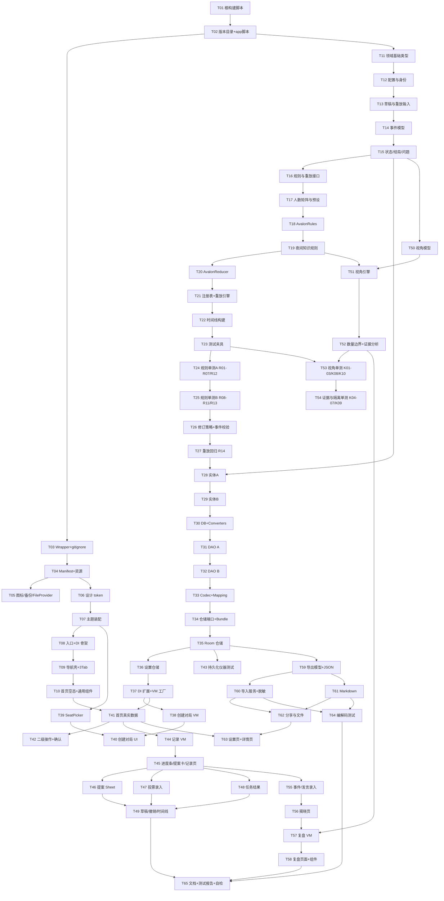

# RoundTrace（局迹）任务分解

> 版本 v1.0 · 2026-10-30
> 依赖设计文档：`docs/ARCHITECTURE.md`（本清单中所有 `§x` 引用均指该文档章节）
> 设计规范：`docs/DESIGN_SPEC.md`
> 上游需求：`01_产品需求文档_PRD.md`、`02_技术实施文档_TDD.md`

---

## 0. 使用说明

1. **路径基准**：所有相对路径以 `RoundTrace/` 为根。Kotlin 源码根为
   `app/src/main/java/com/roundtrace/app/`（下表简写 `src/`），单元测试根为
   `app/src/test/java/com/roundtrace/app/`（简写 `test/`），仪器测试根为
   `app/src/androidTest/java/com/roundtrace/app/`（简写 `androidTest/`）。
2. **顺序即依赖**：任务按编号递增执行。表中「依赖」列出**必须已完成**的任务号；未列出的前置任务默认为 `T(n-1)` 不成立——请以表为准。
3. **粒度**：每个任务 1–5 个文件（绝大多数 ≤3），可一次实现完成、可独立通过编译。
4. **完成定义**：每个任务结束必须 `./gradlew :app:compileDebugKotlin`（或 `testDebugUnitTest`）通过；M3 之后每个任务最好跑一次 `assembleDebug`。**未验证不得声称通过。**
5. **禁止占位**：任何任务不允许产出「静态样例 UI」「TODO 按钮」。若某屏的前置 ViewModel 未就绪，必须先完成该 ViewModel 任务（清单已按此排序）。
6. **每个里程碑结束**都要把验证命令与结果追加到 `docs/TEST_REPORT.md`。

---

## 1. M0 — 工程骨架与 UI 基础（T01–T10）

| 任务号 | 标题 | 涉及文件（相对路径） | 依赖 | 优先级 | 验收标准（可测） |
|---|---|---|---|---|---|
| **T01** | 根构建脚本 | `settings.gradle.kts`、`build.gradle.kts`、`gradle.properties` | — | P0 | ① `settings.gradle.kts` 仅声明 `google()`/`mavenCentral()`，`include(":app")`；② 根 `build.gradle.kts` 全部插件 `apply false`（AGP 8.5.2 / Kotlin 2.0.21 / KSP 2.0.21-1.0.25 / kotlin-serialization 2.0.21 / kotlin-compose 2.0.21）；③ `gradle.properties` 含 `android.useAndroidX=true`、`kotlin.code.style=official`、`org.gradle.jvmargs=-Xmx2048m`；④ 全仓库 grep `"+"` 与 `latest.release` 在依赖声明中**零命中**。 |
| **T02** | 版本目录与 app 模块脚本 | `gradle/libs.versions.toml`、`app/build.gradle.kts`、`app/proguard-rules.pro` | T01 | P0 | ① `libs.versions.toml` 含 ARCHITECTURE §0.1 全部依赖且版本精确；`[plugins]` 含 `kotlin-compose`；② `app/build.gradle.kts`：`namespace = "com.roundtrace.app"`、`compileSdk=34`、`minSdk=26`、`targetSdk=34`、`buildFeatures.compose=true`、`buildFeatures.buildConfig=true`、`kotlin { jvmToolchain(17) }`、Java 17 `compileOptions`；③ `ksp { arg("room.schemaLocation", "$projectDir/schemas") }` 存在；④ `testOptions.unitTests.isReturnDefaultValues = true`；⑤ `packaging.resources.excludes` 含 `META-INF/{AL2.0,LGPL2.1}`；⑥ 无 `composeOptions` 块（Kotlin 2.0 禁用）。 |
| **T03** | Gradle Wrapper 与忽略文件 | `gradle/wrapper/gradle-wrapper.properties`、`gradlew`、`gradlew.bat`、`gradle/wrapper/gradle-wrapper.jar`、`.gitignore` | T01 | P0 | ① wrapper `distributionUrl` 为 `gradle-8.9-bin.zip`；② `./gradlew --version` 输出 Gradle 8.9（需 JDK17）；③ `.gitignore` 忽略 `build/`、`.gradle/`、`local.properties`、`*.apk`、`.idea/`，但**不忽略** `app/schemas/`。 |
| **T04** | Manifest 与资源骨架 | `app/src/main/AndroidManifest.xml`、`app/src/main/res/values/strings.xml`、`app/src/main/res/values/themes.xml`、`app/src/main/res/values-night/themes.xml` | T03 | P0 | ① Manifest 中 grep `uses-permission` **零命中**（P0 不声明任何权限，尤其不得有 `INTERNET`）；② `.MainActivity` 带 `android:exported="true"` + `MAIN`/`LAUNCHER`；③ `android:theme="@style/Theme.RoundTrace"`，`allowBackup="true"` 并引用 `fullBackupContent`/`dataExtractionRules`；④ `strings.xml` 含 `app_name=局迹` 与三个 Tab 文案；⑤ `:app:processDebugResources` 无缺失资源。 |
| **T05** | 图标 / 备份 / FileProvider 资源 | `app/src/main/res/mipmap-anydpi-v26/ic_launcher.xml`、`app/src/main/res/values/colors.xml`、`app/src/main/res/xml/backup_rules.xml`、`app/src/main/res/xml/data_extraction_rules.xml`、`app/src/main/res/xml/file_paths.xml`、`app/src/main/AndroidManifest.xml`（新增 provider 节点） | T04 | P0 | ① 自适应图标（`ic_launcher_background` 色 + 矢量前景），`aapt` 无警告级缺失；② `colors.xml` **只**含图标相关色，不得出现 UI 语义色；③ `file_paths.xml` 声明 `<cache-path name="exports" path="exports/"/>`；④ Manifest 新增 `androidx.core.content.FileProvider`（`authorities="com.roundtrace.app.fileprovider"`、`exported="false"`、`grantUriPermissions="true"`、meta-data 指向 `@xml/file_paths`），`:app:processDebugManifest` 通过。 |
| **T06** | 设计 token（色 / 字 / 形 / 间距） | `src/core/ui/theme/Color.kt`、`src/core/ui/theme/Type.kt`、`src/core/ui/theme/Shape.kt`、`src/core/ui/theme/Dimens.kt` | T04 | P0 | ① `Color.kt` 的浅色与深色两套语义色值与 DESIGN_SPEC §1.1/§1.2 **逐值一致**（22 个语义位）；② `Type.kt` 全部用 `sp`（grep `fontSize = ` 后不得出现 `dp`）；③ `Shape.kt` 提供 12/16/20dp 与胶囊；④ `Dimens.kt` 含 `Spacing4/8/12/16/24/32` 与 `MinTouchTarget = 48.dp`。 |
| **T07** | 主题装配 | `src/core/ui/theme/Theme.kt` | T06 | P0 | ① `RoundTraceTheme(darkTheme, content)` 用 `lightColorScheme`/`darkColorScheme` 装配全部颜色；② 提供 `LocalExtendedColors` 暴露 `success/successContainer/error(errorColorScheme)/unknown/unknownContainer/accent/accentContainer`；③ `dynamicColor` 默认 **false**（禁止动态取色污染设计契约）；④ 在 Preview 中切换 `darkTheme=true/false` 均无缺色。 |
| **T08** | 应用入口与 DI 骨架 | `src/RoundTraceApplication.kt`、`src/MainActivity.kt`、`src/di/AppContainer.kt` | T07 | P0 | ① `Application.onCreate` 仅构造 `AppContainer`（含 `appScope: CoroutineScope`、`Clock`、`IdGenerator`，本阶段不含仓储）；② `MainActivity` 只做 `enableEdgeToEdge()` + `setContent { RoundTraceTheme { RoundTraceNavHost() } }`；③ `:app:assembleDebug` 通过；APP 启动到 T09 完成的导航壳不崩溃。 |
| **T09** | 导航壳与三 Tab | `src/navigation/Routes.kt`、`src/navigation/RoundTraceNavHost.kt`、`src/core/ui/component/RoundTraceScaffold.kt` | T08 | P0 | ① 底部 3 Tab（首页/记录/复盘）可切换且选中态正确；② Tab 高度 ≥64dp、图标 24dp、文字 12sp；③ 每个 Tab 有 `contentDescription`；④ 系统返回从工作流页面回到对应 Tab，不退出 App；⑤ 路由常量集中定义，无字符串魔法值散落。 |
| **T10** | 首页空态与通用状态组件 | `src/feature/home/HomeUiState.kt`、`src/feature/home/HomeScreen.kt`、`src/core/ui/component/EmptyState.kt`、`src/core/ui/component/StatusBadge.kt` | T09 | P0 | ① 首页空态标题「还没有对局记录」+ 副文案「开始记录你的第一局阿瓦隆」+ 按钮「开始一局」，与 DESIGN_SPEC §5 逐字一致；② `StatusBadge` 四态（成功/失败/未知/待处理）均渲染「颜色+图标+文字」三重表达；③ `HomeScreen` 为**无状态**可组合函数（接收 `HomeUiState`），无硬编码列表数据；④ 夜间模式切换无硬编码颜色。 |

---

## 2. M1 — 领域规则引擎与单测（T11–T27）

> 本里程碑**全部是纯 Kotlin**，禁止任何 `android.*` / `androidx.compose.*` import（ARCHITECTURE D1）。
> 完成后 `./gradlew :app:testDebugUnitTest` 必须全绿。

| 任务号 | 标题 | 涉及文件 | 依赖 | 优先级 | 验收标准 |
|---|---|---|---|---|---|
| **T11** | 领域基础类型 | `src/core/model/Ids.kt`、`src/core/model/Enums.kt` | T02 | P0 | ① `MatchId`/`EventId` 为 `@JvmInline value class`，`SeatId` 为 `Int` typealias；② `Enums.kt` 完整实现 ARCHITECTURE §2.1 全部枚举（`RoleId.alignment` 正确映射 8 个角色）；③ `RoleId.fromPersisted(null)` 返回 `UNKNOWN` 而非抛异常；④ 无 android import。 |
| **T12** | 配置与身份模型 | `src/core/model/GameConfig.kt`、`src/core/model/Participant.kt`、`src/core/model/RoleAssignment.kt` | T11 | P0 | ① `GameConfig.plannedCount/plannedAlignmentCount/hasRole` 实现正确（有 assert 断言：8 人标准 good=5/evil=3）；② `RoleAssignment.alignment` 委托 `roleId.alignment`；③ `RevealState` 三值齐备；④ `roleSlots` 为空时 `plannedCount` 返回 0 不崩溃。 |
| **T13** | 创建草稿与重放输入模型 | `src/core/model/MatchSummary.kt`、`src/core/model/MatchCreationDraft.kt`、`src/core/model/ReconstructedMatch.kt` | T12 | P0 | ① `GamePosition.includes(order)` 语义为 `order <= occurredOrder`；② `GamePosition.start()` = 0，`includes(0)==true`、`includes(1)==false`；③ `MatchCreationDraft` 覆盖 FR-02 所有输入（人数、roleSlots、mySeat、leader、title、participants）；④ `ReconstructedMatch.revealedAt = null` 表示未揭晓。 |
| **T14** | 事件模型（sealed + 工厂） | `src/core/model/MatchEvent.kt`、`src/core/model/EventFactory.kt` | T13 | P0 | ① 10 个事件类型全部实现 `MatchEvent` 的 8 个抽象成员（`eventId/occurredOrder/recordedAt/visibility/supersedesId/retracted/questNo/type`）；② `type` 为 `val ... get()` 推导，不可变；③ `EventFactory` 为每个事件提供构造方法，填充 `eventId = UUID`、`recordedAt = clock`、`occurredOrder = 0`；④ `PrivateNoteAdded.visibility` 默认 `PRIVATE_OBSERVER`，其余默认 `PUBLIC`；⑤ 用 kotlin `when` 穷举 10 类型无 else 分支可编译（sealed 完整性）。 |
| **T15** | 状态、结局与校验问题模型 | `src/core/model/GameState.kt`、`src/core/model/GameOutcome.kt`、`src/core/model/RuleIssue.kt` | T14 | P0 | ① `GameState` 字段与 ARCHITECTURE §2.4 一致，`quests` 按 `questNo` 升序不可变；② `IssueCode` 覆盖 §2.4 全部枚举值（≥28 个）；③ `RuleIssue.args` 为 `Map<String,String>`，不含中文硬编码文案；④ `GameOutcome.winner` 只允许 `GOOD`/`EVIL`（用 `require` 断言拒绝 `UNKNOWN`）。 |
| **T16** | 规则与重放接口 | `src/core/rules/GameRules.kt`、`src/core/rules/GameReducer.kt`、`src/core/rules/GameRulesRegistry.kt` | T15 | P0 | ① 接口签名与 ARCHITECTURE §3 **逐字一致**；② `ReductionResult` 含 `state` + `issues`；③ `RulesetDescriptor` 含 `rulesetId/version/displayName/gameType/presetIds`；④ 接口无 default 实现（避免规则散落）。 |
| **T17** | 标准人数矩阵与预设 | `src/core/rules/avalon/AvalonPreset.kt`、`test/rules/AvalonPresetCompositionTest.kt` | T16 | P0 | ① 5–10 人 `good/evil/teamSizes` 与 PRD §6.1 表格**逐格一致**；② `standardPreset(playerCount)` 的 `roleSlots` **严格按 ARCHITECTURE §9.3.1 两张表逐行实现**：5/6 人 = 梅林1+忠臣2或3 / 刺客1+爪牙1（**无派西维尔**）；7 人 = 梅林1+派西维尔1+忠臣2 / 刺客1+莫甘娜1+爪牙1；8、9 人 = 梅林1+派西维尔1+忠臣3或4 / 刺客1+莫甘娜1+莫德雷德1；10 人 = 梅林1+派西维尔1+忠臣4 / 刺客1+莫甘娜1+莫德雷德1+**奥伯伦1**；③ 每行断言 `MERLIN+PERCIVAL+LOYAL_SERVANT == good`、`ASSASSIN+MORGANA+MORDRED+MINION+OBERON == evil`、角色总数 `== playerCount`；④ 8 人局生成的 `roleSlots` 必须能装出 TDD §11 夹具的 8 个角色（交叉校验）；⑤ **5 人局 `PERCIVAL` 计数必须为 0、10 人局 `OBERON` 计数必须为 1**（两条反向断言，防回归）；⑥ 非法人数（<5 或 >10）抛 `IllegalArgumentException`；⑦ `AvalonPresetCompositionTest` 用 `@ParameterizedTest`/参数化断言覆盖 **6 种人数**，本任务内跑绿。 |
| **T18** | 规则判定与 setup 校验（AvalonRules） | `src/core/rules/avalon/AvalonRules.kt` | T17 | P0 | ① `teamSize/failThreshold/isTeamApproved/isMissionFailed` 与 TDD §4.1 公式一致（`failThreshold = 2` 当且仅当 `playerCount>=7 && questNo==4`）；② `validateSetup` 覆盖 §2.4 中 7 个配置类 `IssueCode`；③ 唯一性：梅林/刺客/派西维尔/莫甘娜/莫德雷德/奥伯伦各 ≤1，梅林与刺客标准局必须各 1；④ `determineOutcome` 在 `AWAITING_ASSASSINATION` 时返回 `null`；⑤ `AvalonRules` 上无 `@Composable`/无 Context。 |
| **T19** | 夜间知识规则 | `src/core/rules/avalon/AvalonRoleKnowledge.kt` | T18 | P0 | ① 梅林 `visibleEvilSeats` **同时排除** `MORDRED` 与 `OBERON`（两个排除要各自断言，不得只测其一）；② 派西维尔：存在 `MORGANA` 时 `merlinCandidates = [MERLIN, MORGANA]`，不存在时只含 `MERLIN`；③ 坏人互认 `evilTeammates` 排除 `OBERON` 与自身；④ **奥伯伦自身**得到空 `NightKnowledge`（三个列表全空），不得因「他是坏人」返回同伴；⑤ 输入角色含 `UNKNOWN` 时返回空知识列表且不抛异常；⑥ 输出 `NightKnowledge` 为纯数据。 |
| **T20** | 状态机 reducer（AvalonReducer） | `src/core/rules/avalon/AvalonReducer.kt` | T19 | P0 | ① ARCHITECTURE §6.1 表格 10 行行为**逐行实现**；② 终局优先级按 §6.2（含 `NO_ASSASSIN_PRESENT` 分支）；③ `R`（连续否决）在 `QUEST_STARTED` / 提案批准 / 任务结算后归零；④ 未核实任务（`verified=false`）**不计入** `goodSuccessCount`/`evilFailureCount`；⑤ 任何非法事件只产生 `RuleIssue`，reducer **不抛异常**；⑥ 提案可判定性按 §6.3 三分支实现。 |
| **T21** | 规则注册表实现与重放引擎 | `src/core/rules/DefaultGameRulesRegistry.kt`、`src/core/replay/ReplayEngine.kt` | T20 | P0 | ① `rulesFor("avalon.standard", 1)` 返回 `AvalonRules`；未知 `rulesetId`/`version` 抛带明确信息的 `IllegalArgumentException`；② `ReplayEngine.replay(match, upTo)` 过滤 `retracted` → 按 `occurredOrder` 升序 → 逐步 `step`；③ `issues` 去重后返回（同一 `code+eventId` 只保留一条）；④ `upTo=null` 重放到最新；⑤ 重放**幂等**：同一输入两次 `replay` 结果 `==`。 |
| **T22** | 时间线构建 | `src/core/replay/TimelineEntry.kt`、`src/core/replay/TimelineBuilder.kt` | T21 | P0 | ① 每个事件生成 1 条 `TimelineEntry`，按 `occurredOrder` 升序；② `TimelineEntry` 含 `occurredOrder/phaseLabel/title/detail/unrecordedFields/sourceEventIds`；③ 未记录字段以 `null` 出现在 `unrecordedFields`，UI 层渲染 `—— 未记录`；④ 同一任务多次提案能正确分组（无合并丢失）。 |
| **T23** | 测试夹具与真实案例 fixture | `test/util/MatchBuilder.kt`、`test/util/RoleFixtures.kt`、`app/src/test/resources/fixtures/avalon_eight_merlin_mordred.json` | T22 | P0 | ① `MatchBuilder.eightPlayerMerlinMordred()` 构造 TDD §11 角色表（1梅林/2忠臣/3莫甘娜/4莫德雷德/5刺客/6忠臣/7派西维尔/8忠臣）；② 支持链式追加 5 个任务的事件且保留 `UNKNOWN`（任务 4 缺 2 名队员、任务 5 投票语义未确认）；③ fixture JSON 可被 `kotlinx-serialization` 解析且字段与 TDD §11 一致；④ 另提供 `MatchBuilder.tenPlayerWithOberon()`（1 梅林/1 派西维尔/4 忠臣 + 1 刺客/1 莫甘娜/1 莫德雷德/1 奥伯伦），供 P02 的奥伯伦三条排除规则断言使用。 |
| **T24** | 规则单测 A（R01–R07、R12） | `test/rules/AvalonPresetMatrixTest.kt`、`test/rules/AvalonVoteRulesTest.kt`、`test/rules/AvalonMissionRulesTest.kt` | T23 | P0 | ① 覆盖 R01–R07、R12 共 8 条（见 §5 归属表），每条至少 1 个 `@Test`；② 全部通过 `./gradlew :app:testDebugUnitTest`；③ 断言消息写明期望值与实际值。 |
| **T25** | 规则单测 B（R08–R11、R13） | `test/rules/AvalonStateMachineTest.kt`、`test/rules/AvalonAssassinationTest.kt`、`test/rules/AvalonSetupValidationTest.kt` | T24 | P0 | ① 覆盖 R08/R09/R10/R11/R13(setup 部分)；② R10 含「命中/未命中/角色未知」三个分支；③ R13 断言「草稿态可保存（validateEvent 返回非 BLOCKING 或空）而确认态不合法（返回 BLOCKING）」；④ 全绿。 |
| **T26** | 事件修订策略与事件校验单测 | `src/core/data/EventRevisionPolicy.kt`、`test/data/EventRevisionPolicyTest.kt`、`test/rules/AvalonEventValidationTest.kt` | T25 | P0 | ① `canSupersede` 规则：同对局、同 `EventType`、目标 `retracted==false`、不可跨任务类型（`QUEST_STARTED` 不可被 `MISSION_RESOLVED` 替代）；② 覆盖 R13（事件部分：队伍少一人/重复座位/票数超人数）与 R14 的前置约束；③ 全绿。 |
| **T27** | 重放回归单测（R14） | `test/rules/AvalonReducerReplayTest.kt` | T26 | P0 | ① 构造 4 个任务的事件列表 → 全量 replay → 记录 `GameState`；② 用修订后事件列表（第 2 任务队伍被改、第 4 任务补全成员）再 replay，断言 `goodSuccessCount/evilFailureCount/status/issues` 按新事实重算且**不保留**旧结论；③ 断言冲突时产生对应 `IssueCode`（`DECISION_VOTE_CONFLICT`/`MISSION_TEAM_MISMATCH`）；④ 全绿。 |

---

## 3. M2 — Room、Repository 与创建对局（T28–T43）

| 任务号 | 标题 | 涉及文件 | 依赖 | 优先级 | 验收标准 |
|---|---|---|---|---|---|
| **T28** | 持久化实体 A | `src/core/database/entity/MatchEntity.kt`、`ParticipantEntity.kt`、`RoleAssignmentEntity.kt` | T15, T02 | P0 | ① 列名/类型与 ARCHITECTURE §4.2–§4.4 一致；② `participants` 与 `role_assignments` 均声明 `Index(["matchId","seatNumber"], unique = true)` 与 `ForeignKey(onDelete = CASCADE)`；③ `matches` 声明 `index_matches_status_updatedAt`；④ 编译后 `app/schemas/...1.json` 生成。 |
| **T29** | 持久化实体 B | `src/core/database/entity/MatchEventEntity.kt`、`MatchDraftEntity.kt`、`AnalysisReportEntity.kt` | T28 | P0 | ① `match_events` 三索引（`matchId+occurredOrder`、`matchId+eventType`、`supersedesId`）；② `match_drafts` 复合主键 `["matchId","screenKey"]`；③ `analysis_reports` 唯一索引 `["matchId","eventRevision","perspectiveKey"]`；④ 所有子表 FK CASCADE。 |
| **T30** | 数据库与转换器 | `src/core/database/RoundTraceDatabase.kt`、`src/core/database/Converters.kt` | T29 | P0 | ① `@Database(version=1, exportSchema=true)` 含 6 个实体；② Builder 开启 `setJournalMode(WAL)`（默认即可，需显式声明）且**不使用** `fallbackToDestructiveMigration()`；③ 6 个 DAO 抽象属性齐备；④ `:app:compileDebugKotlin` 通过（KSP 生成实现）。 |
| **T31** | DAO A | `src/core/database/dao/MatchDao.kt`、`ParticipantDao.kt`、`RoleAssignmentDao.kt`、`src/core/database/dao/MatchSummaryRow.kt` | T30 | P0 | ① 方法签名与 §5.1–§5.3 一致（`Flow`/`suspend` 不可混用错）；② `observeSummaries` 的投影 SQL 能返回 `questsStarted`；③ `MatchSummaryRow` 字段名与 SQL 别名逐字一致；④ `:app:compileDebugKotlin` 通过。 |
| **T32** | DAO B | `src/core/database/dao/MatchEventDao.kt`、`MatchDraftDao.kt`、`AnalysisReportDao.kt` | T31 | P0 | ① §5.4–§5.6 全部方法实现；② `appendWithOrder` 与 `reviseSupersede` 为 `@Transaction` 且内部完成「取 order → insert → 更新 matches.updatedAt」；③ 两个复合写返回实际 `occurredOrder`；④ 编译通过（Room 校验 SQL 语法）。 |
| **T33** | 事件编解码与实体映射 | `src/core/database/EventCodec.kt`、`src/core/database/Mapping.kt` | T32 | P0 | ① `encode(event): MatchEventEntity` 只把**事件专有字段**写入 `payloadJson`（`payloadVersion=1`）；② `decode(entity): MatchEvent` 用 `eventType` 分派，未知 `eventType` 抛带类型的异常（不静默返回 null）；③ `Mapping` 完成 `MatchEntity↔MatchSummary/GameConfig`、`ParticipantEntity↔Participant`、`RoleAssignmentEntity↔RoleAssignment`；④ `decode(encode(e)) == e` 对 10 种事件类型成立（由 T64 的测试钉住，本任务至少手动/临时断言）。 |
| **T34** | 仓储端口与 Bundle | `src/core/data/MatchRepository.kt`、`src/core/data/MatchBundle.kt`、`src/core/data/SettingsRepository.kt` | T33 | P0 | ① 端口签名与 ARCHITECTURE §3.1 一致；② `MatchBundle.toReconstructedMatch()` 直接映射；③ `SettingsRepository` 定义 `themeMode`/`defaultPlayerCount`/`includePrivateByDefault` 的 `Flow` + setter；④ 端口不含任何 Room 类型。 |
| **T35** | Room 仓储实现 | `src/core/data/RoomMatchRepository.kt` | T34 | P0 | ① `createMatch` 在**单事务**内写 `matches`+`participants`+`role_assignments`；② `appendEvent` 分配 order、写事件、touch 对局、返回 `AppendResult(issues)`；③ `appendEvent` 在 `eventType==TeamProposed` 且该任务无 `QUEST_STARTED` 时**自动补建** `QUEST_STARTED`（同一事务，ARCHITECTURE §9.3-18）；④ `reviseEvent` 校验 `EventRevisionPolicy` 后双写（新事件 + 旧 `retracted=1`）；⑤ `deleteMatch` 依赖 FK CASCADE 一条 DELETE 完成；⑥ 全程 `suspend`，无 `runBlocking`、无主线程 IO。 |
| **T36** | 设置仓储（DataStore） | `src/core/data/DataStoreSettingsRepository.kt` | T35 | P0 | ① 用 `preferencesDataStore("roundtrace_settings")`；② 三项设置均有默认值且 `Flow` 可持续观察；③ 写入 `suspend`；④ 不把整场对局写入 DataStore（TDD §8 底线）。 |
| **T37** | DI 扩展与 ViewModel 工厂 | `src/di/AppContainer.kt`（改）、`src/di/ViewModelFactories.kt` | T36 | P0 | ① `AppContainer` 暴露 `database/gameRegistry/reducer/knowledgeProvider/analyzer/matchRepository/settingsRepository`；② `ViewModelFactories` 用 `viewModelFactory { initializer { ... } }` 提供各 VM；③ `AppContainer` 为 `lazy` 单例，进程内唯一 Database 实例；④ 编译通过。 |
| **T38** | 创建对局 ViewModel | `src/feature/create/CreateMatchUiState.kt`、`src/feature/create/CreateMatchViewModel.kt` | T37 | P0 | ① `onAction` 覆盖人数/角色槽/座位/队长/标题变更；② 每次变更调 `AvalonRules.validateSetup` 并暴露 `issues` 与 `canCreate`；③ `canCreate` 仅在无 `BLOCKING` issue 时为 true；④ `confirm()` 调 `createMatch` 并回传 `MatchId`（用 fake repository 的单测或 `@VisibleForTesting` 断言）。 |
| **T39** | 座位选择组件（SeatPicker） | `src/core/ui/component/SeatPicker.kt` | T07 | P0 | ① 支持 5–10 座位；一行 5 列，单格 ≥56dp；② 单选/多选模式通过参数切换；③ 选中态 = `primaryContainer` 底 + 2dp `primary` 描边；④ `contentDescription` 格式「4 号座位，当前未选中」/「4 号座位，已选中，队长」；⑤ 支持徽标（≤14dp 图标）；⑥ TalkBack 下可遍历全部座位。 |
| **T40** | 创建对局 UI | `src/feature/create/CreateMatchScreen.kt` | T39, T38 | P0 | ① 分步表单：人数 → 角色构成 → 我的座位 → 首任队长 → 标题 → 创建；② 角色构成实时显示好人/坏人数量与总数，非法时禁用创建并展示具体 `RuleIssue` 文案（走 `stringResource`）；③ 我的身份输入区默认遮挡（`SecretRevealBox` 或 `•••`）；④ 创建成功导航到记录页并携带 `matchId`；⑤ 全流程无需键盘即可完成。 |
| **T41** | 首页真实数据接线 | `src/feature/home/HomeViewModel.kt`、`src/core/ui/component/MatchCard.kt`、`src/feature/home/HomeScreen.kt`（改） | T37, T10 | P0 | ① `HomeViewModel` 观察 `observeSummaries(filter)`；② 筛选「全部/进行中/已结束」生效；③ `MatchCard` 展示标题、人数、`QuestStepper` 迷你版、状态徽标、更新时间，整卡可点；④ 有 loading/empty/error 三态，error 可重试；⑤ 硬编码样例数据全部移除。 |
| **T42** | 首页二级操作与确认对话框 | `src/feature/home/MatchOverflowSheet.kt`、`src/core/ui/component/ConfirmDialog.kt` | T41 | P0 | ① overflow 菜单：重命名/删除/导出（导出项在 T63 前可先跳详情页，不得放无响应按钮）；② 删除必须 `AlertDialog` 二次确认；③ 重命名写入 `matches.title` 并回落列表；④ 误触返回不删除任何数据（无隐式删除路径）。 |
| **T43** | 持久化与恢复仪器测试 | `androidTest/database/MatchDaoTest.kt`、`androidTest/data/RoomMatchRepositoryTest.kt` | T35 | P0 | ① D01：写入 20 条事件后重新打开数据库，`occurredOrder` 连续且顺序完整；② CASCADE：删除 match 后 5 张子表零残留；③ D03：修订后旧事件 `retracted=1` 且 `listActive` 不再返回；④ 全部通过 `connectedDebugAndroidTest`（无设备时在 `TEST_REPORT.md` 记录为「未执行 + 原因」）。 |

---

## 4. M3 — 现场记录全流程（T44–T49）

| 任务号 | 标题 | 涉及文件 | 依赖 | 优先级 | 验收标准 |
|---|---|---|---|---|---|
| **T44** | 记录 UiState 与 ViewModel | `src/feature/record/RecordUiState.kt`、`src/feature/record/RecordViewModel.kt` | T41 | P0 | ① `RecordUiState` 字段与 TDD §7.3 一致（`match/quest/draft/saveStatus/issues/isLoading`）；② `RecordAction` 覆盖 `SelectLeader/ToggleTeamSeat/SetVote/SetMissionFailCount/SaveDraft/ConfirmProposal/Undo`；③ ViewModel 暴露只读 `StateFlow`，`onAction` 为唯一入口；④ 内部用 `observeBundle → ReplayEngine.replay` 派生状态，**不重复计算规则**；⑤ 单测：给定 fake repository，`ToggleTeamSeat` 超员时 `issues` 出现 `TEAM_SIZE_MISMATCH`。 |
| **T45** | 进度条、提案卡、保存状态与记录页 | `src/core/ui/component/QuestStepper.kt`、`ProposalCard.kt`、`SaveStatusBar.kt`、`src/feature/record/RecordScreen.kt` | T44 | P0 | ① `QuestStepper` 5 个节点，当前任务放大 + 「第 N 任务」文字；已完成按成功/失败着色 + 图标；② `ProposalCard` 的**组队投票区**与**任务牌结果区**用 `HorizontalDivider` 分隔且视觉不同（票数用「赞成/反对」，任务牌用「失败牌数」）；③ `SaveStatusBar` 三态（已保存/保存中/失败+重试）；④ 记录页含 `TopBar` + 任务切换 + 座位网格 + 当前提案卡 + 底部主操作；⑤ 8 人局「选队长→选 4 人→投票汇总→任务结果」全程不需要键盘。 |
| **T46** | 提案录入 Sheet | `src/feature/record/ProposalSheet.kt` | T45 | P0 | ① 单选队长 + 多选队员（复用 `SeatPicker`）；② 实时显示「已选 3/4 人」与任务人数规则；③ 超员/重复座位禁用提交并显示原因；④ 提交后事件落库、`ProposalCard` 立即出现（真实持久化，非内存态）；⑤ 允许「只选部分成员后暂存」（走草稿，不产生非法确认事件）。 |
| **T47** | 投票录入 | `src/core/ui/component/VoteRecorder.kt`、`src/feature/record/VoteSheet.kt` | T45 | P0 | ① 双模式：逐人三态循环（同意/反对/未知）与汇总双步进器（赞成 N/反对 M，剩余自动为未知）；② 实时显示「赞成 7 > 半数 4 → 通过」，平票显示「平票视为否决」；③ 实时校验 `赞成+反对 ≤ 人数`，越界禁用保存；④ 保存后写入 `TEAM_VOTE_RECORDED`；⑤ **UI 上绝不存在把「反对票」写成「失败牌」的控件**。 |
| **T48** | 任务结果录入 | `src/core/ui/component/MissionOutcomeSelector.kt`、`src/feature/record/MissionSheet.kt` | T45 | P0 | ① 独立卡片标题含「任务牌（不是投票）」；② 失败牌数分段选择 0/1/2/3/未知；③ 实时规则判定文案：「第 4 任务需 ≥2 张失败牌 → 本任务成功（含 1 张失败牌）」；④ 失败牌数未知时结果显示「结果未知」且不写 `MissionOutcome`；⑤ 保存后任务节点状态与时序刷新。 |
| **T49** | 草稿自动保存、撤销与记录内时间线 | `src/feature/record/RecordTimelineSection.kt`、`src/feature/record/RecordViewModel.kt`（改） | T46, T47, T48 | P0 | ① 表单变更 300ms 防抖写入 `match_drafts`，杀进程重进后草稿恢复；② `Undo` 撤销最近一次事件（`retractEvent`）并弹 Snackbar 提供反悔；③ 记录页内嵌时间线按 `occurredOrder` 展示全部事件，未记录字段显示 `—— 未记录`；④ 旋转/切后台不丢已保存数据；⑤ 五连否决场景可完整录入并在第 5 次时立刻显示「坏人胜利」。 |

---

## 5. M4 — 事件、揭晓、时间线与视角复盘（T50–T58）

| 任务号 | 标题 | 涉及文件 | 依赖 | 优先级 | 验收标准 |
|---|---|---|---|---|---|
| **T50** | 信息视角模型 | `src/core/model/Knowledge.kt` | T15 | P0 | ① `KnowledgeSnapshot` 全部字段与 ARCHITECTURE §7.1 一致；② `EvidenceFinding` 含 `ruleId` 与 `sourceEventIds`；③ `KnowledgeBasis` 含 `RECONSTRUCTED_INITIAL`；④ `SeatKnowledge.knownAlignment` 用 `Alignment?`（null = 未知，不用 `UNKNOWN` 表示未知以免混淆）；⑤ 无 android import。 |
| **T51** | 视角引擎 | `src/core/knowledge/KnowledgeProvider.kt`、`src/core/knowledge/AvalonKnowledgeProvider.kt` | T50, T19 | P0 | ① 严格执行「只用 `occurredOrder <= at` 的事件」；② `PUBLIC` 模式 `privateRoleFacts`/`subjectiveBeliefs` 为空；③ `OBSERVER_AT_TIME` 只返回 `subjectSeat == observer` 的私有事实与 `availableFromOrder <= at` 的笔记；④ 观察者角色在结局后补录时 `observerRoleIsReconstructed = true`；⑤ `canOpenGodView` 按 ARCHITECTURE §9.3-7 判据；⑥ `GOD_AFTER_REVEAL` 在 `revealedAt == null` 时**抛 `IllegalStateException`**（调用方必须先检查）。 |
| **T52** | 数量边界与证据分析 | `src/core/knowledge/TeamCountBounds.kt`、`src/core/knowledge/ReplayAnalyzer.kt`、`src/core/knowledge/AvalonEvidenceAnalyzer.kt` | T51 | P0 | ① `bounds()` 实现 ARCHITECTURE §7.4 公式，自检用例 K07 输出 `minEvil=1`；② 分析器实现 §7.5 全部 12 条 `ruleId`；③ 每条 finding 必带 `sourceEventIds`（无证据时标 `INFERENCE` 并在 explanation 说明）；④ 绝不输出百分比概率；⑤ 任务成功不产生座位级确定结论（`A04_SUCCESS_NOT_CLEAR` 必出现）。 |
| **T53** | 视角单测（梅林/派西维尔/忠臣） | `test/knowledge/MerlinKnowledgeTest.kt`、`PercivalKnowledgeTest.kt`、`LoyalServantKnowledgeTest.kt` | T52, T23 | P0 | ① 覆盖 K01/K02/K03/K08/K10（见 §6 归属表）；② 梅林不包含 4 号莫德雷德；③ 派西维尔候选为 [1,3] 且不区分真假；④ 角色缺失时 `unknowns` 非空且 `seatKnowledge` 为未知；⑤ 全绿。 |
| **T54** | 证据与隔离单测 | `test/knowledge/EvilTeamKnowledgeTest.kt`、`EvidenceAnalyzerTest.kt`、`PerspectiveIsolationTest.kt` | T53 | P0 | ① 覆盖 K04/K05/K06/K07/K09；② K09 断言「上帝视角看到真相后切回第 3 轮当时视角，`knownAlignment` 不含莫德雷德」；③ K07 断言输出「至少 1 名坏人」且**不点名** 4 号；④ P02：用 10 人 fixture 断言奥伯伦的**三条独立规则**——不在梅林可见集合内、不参与坏人互认（双向）、自身知识为空；⑤ 全绿。 |
| **T55** | 事件 / 发言录入 | `src/core/ui/component/ClaimQuickAdd.kt`、`src/feature/claim/ClaimUiState.kt`、`ClaimViewModel.kt`、`ClaimScreen.kt` | T45 | P0 | ① 8 个预置 Chip（怀疑/保护/跳身份/对跳/推荐组队/改站边/关键言论/其他）；② 主路径 ≤3 次触控（标签→发言者→目标）；③ 「跳身份」渲染为虚线框 + 「声称」前缀，与真实身份视觉永久区分；④ 保存后 `PLAYER_CLAIMED` 落库，**不修改** `role_assignments`（K08/AC-05）；⑤ 支持「私人笔记」模式写 `PRIVATE_NOTE_ADDED` 且 `availableFromOrder` 可设为更早任务。 |
| **T56** | 结局揭晓页 | `src/feature/reveal/RevealUiState.kt`、`RevealViewModel.kt`、`RevealScreen.kt` | T55 | P0 | ① 逐座位填真实角色（可选「仍未知」）；② 支持填胜方/获胜原因/刺杀目标；③ 点「揭晓」调 `revealAllRoles` 并写 `revealedAt`；④ 3 次任务成功后自动进入 `AWAITING_ASSASSINATION`，界面明确提示「不能直接认定好人获胜」；⑤ 角色不完整时保存成功但高级结论区显示「信息不足」；⑥ 刺杀记录后按规则判定胜负并写 `status`。 |
| **T57** | 复盘 UiState 与 ViewModel | `src/feature/replay/ReplayUiState.kt`、`src/feature/replay/ReplayViewModel.kt` | T52, T56 | P0 | ① 支持选任务/选事件位置（`GamePosition`）；② 视角切换三态，`GOD` 在 `canOpenGodView=false` 时被拒绝并返回提示；③ 每次切换重新计算 snapshot + findings + timeline；④ 事件被修订后衍生结论自动刷新（订阅 Flow，无缓存残留）；⑤ 单测：fake bundle 下切换视角不抛异常。 |
| **T58** | 复盘页面与组件 | `src/feature/replay/ReplayScreen.kt`、`src/core/ui/component/PerspectiveSwitcher.kt`、`TimelineEventCard.kt`、`EvidenceCard.kt` | T57 | P0 | ① `PerspectiveSwitcher` 三段，上帝禁用态点击提示「对局结束后可查看」；② 页面常驻说明「当前视角：1 号梅林，截至第 3 任务」；③ 上帝视角有 `accentContainer` 顶部横幅；④ `EvidenceCard` 四段（结论→确定性徽标→证据编号→展开解释），「推测」必须显式带字样且与「规则确定」不同色形；⑤ 空态「暂无可用分析」+ 按钮；⑥ 1.3x 字体不裁切。 |

---

## 6. M5 — 数据交换、质量收尾（T59–T65）

| 任务号 | 标题 | 涉及文件 | 依赖 | 优先级 | 验收标准 |
|---|---|---|---|---|---|
| **T59** | 导出模型与 JSON 编解码 | `src/core/export/ExportModels.kt`、`src/core/export/MatchJsonCodec.kt` | T35 | P0 | ① `ExportBundle(schemaVersion=1, app="RoundTrace", gameType, ruleset{id,version}, match, participants, roles, events, exportOptions)` 与 TDD §3.4 一致；② `export()` 输出稳定字段顺序（`prettyPrint` + 显式 `@SerialName`）；③ `import()` 对未知 `schemaVersion`、缺失必填字段、类型错误均返回 `ImportResult.Failure(reason)` 而**不抛异常**；④ 往返：`import(export(bundle))` 的座位/事件数量/关键字段一致。 |
| **T60** | 导入服务与脱敏 | `src/core/export/ImportExportService.kt`、`src/core/export/VisibilityFilter.kt` | T59, T35 | P0 | ① `exportJson(matchId, options)` 默认 `includeSecrets=false, includePrivateNotes=false`；② 脱敏后 `roles` 只保留 `REVEALED`，`PRIVATE_NOTE_ADDED` 事件被剔除；③ `importFromJson` 单事务写库、重建新 UUID（**绝不覆盖**已有对局），失败零残留；④ 导入前做 `validateSetup` + 结构校验；⑤ P0 不写 `analysis_reports`。 |
| **T61** | Markdown 摘要 | `src/core/export/MarkdownExporter.kt` | T59 | P0 | ① 结构含：基础信息、任务摘要表、提案投票记录、关键发言、结局、规则确定结论、遗留未知事项（TDD §8）；② 失败牌与反对票分别成列，永不混用；③ 默认脱敏；④ 纯字符串输出，无 Android 依赖。 |
| **T62** | 分享与文件选择 | `src/core/export/ShareLauncher.kt`、`app/src/main/res/xml/file_paths.xml`（接线） | T60, T61 | P0 | ① 写临时文件到 `cacheDir/exports/` 并通过 FileProvider 分享（`ACTION_SEND`，`text/plain` + `application/json`）；② 导出到用户选择位置用 `ACTION_CREATE_DOCUMENT`，导入用 `ACTION_OPEN_DOCUMENT`；③ 不申请存储权限；④ 分享前弹窗展示「将包含：公开事件 / 不含：真实身份、私人笔记」。 |
| **T63** | 设置页与对局详情页 | `src/feature/settings/SettingsUiState.kt`、`SettingsViewModel.kt`、`SettingsScreen.kt`、`src/feature/detail/MatchDetailScreen.kt` | T62, T41 | P0 | ① 设置页：主题模式（跟随系统/浅/深）、默认人数、默认是否含私有信息；写 DataStore 后立即生效且重启保留；② 设置页含「导入对局」入口；③ 详情页展示元信息 + 编辑/删除/分享（JSON/Markdown）+ 导入结果反馈；④ 所有按钮均有真实行为，无「规划中」可点假入口。 |
| **T64** | 编解码与导出单测 | `test/export/JsonCodecTest.kt`、`MarkdownExporterTest.kt`、`test/export/ImportValidationTest.kt` | T60, T61 | P0 | ① D02：导出→导入→字段一致（座位、事件顺序、提案/投票/任务结果、获得授权时的真实身份）；② D04：坏 JSON / 未知 schema / 缺字段三种输入均返回可读 `Failure` 且不产生半场对局；③ Markdown 断言「反对票」与「失败牌」出现在不同小节；④ 全绿。 |
| **T65** | 文档、测试报告与最终自检 | `README.md`、`docs/TEST_REPORT.md`、`docs/decisions.md`（骨架，内容由工程按 ARCHITECTURE §9.4 填写） | T64, T58, T49 | P0 | ① README 含：环境要求、构建命令、测试命令、依赖版本表与验证结果、架构简述、已知限制、APK 路径（**存在才写**）；② `TEST_REPORT.md` 逐条列出 R01–R14/K01–K10/D01–D04/U01–U05 的通过/未执行与原因；③ `decisions.md` 覆盖 ARCHITECTURE §9.4 的 16 条；④ 全仓库 grep 检查 D1–D5（ARCHITECTURE §1.2）零违规；⑤ 飞行模式下冷启动→创建→记录→复盘→导出全通（AC-09）。 |

---

## 7. 任务依赖图（里程碑级）

> 里程碑内部按任务号顺序推进；跨里程碑的关键依赖如下。

**关键路径**：T01→T02→T11→T12→…→T20→T21→T28→T30→T32→T35→T41→T44→T45→T46/47/48→T49→T65。

---

## 8. 测试用例归属表（TDD §10 全 24 条 + D/U 类）

### 8.0 本设计新增的强制用例（TDD §10 未覆盖，不得省略）

| ID | 测试 | 期望 | 实现任务 | 测试文件 |
|---|---|---|---|---|
| **P01** | 6 种人数（5/6/7/8/9/10）的标准预设**角色构成**断言 | 逐行匹配 ARCHITECTURE §9.3.1：5/6 人无派西维尔、7 人起有派西维尔、8/9 人有莫德雷德、10 人有奥伯伦；每行 `好人数==good`、`坏人数==evil`、角色总数 `==playerCount`；8 人可装出 TDD §11 夹具 | **T17** | `test/rules/AvalonPresetCompositionTest.kt` |
| **P02** | 奥伯伦的三条排除规则 | 奥伯伦不在梅林可见集合内；奥伯伦不参与坏人互认（双向不可见）；奥伯伦自身知识为空 | **T19**（实现）+ **T54**（断言，用 10 人 fixture） | `test/knowledge/EvilTeamKnowledgeTest.kt` |
| **P03** | `RoleId.fromPersisted` 容错 | `null` / 未知字符串 → `UNKNOWN`，不抛异常 | **T11** | 随 T11 内联断言 |

### 8.1 规则用例 R01–R14

| ID | 输入摘要 | 期望 | 实现任务 | 测试文件 |
|---|---|---|---|---|
| R01 | 5/6/7/8/9/10 人 | 阵营人数与任务人数矩阵严格正确 | **T24** | `test/rules/AvalonPresetMatrixTest.kt` |
| R02 | 8 人 4 赞成 4 反对 | 组队否决（平票不过） | **T24** | `test/rules/AvalonVoteRulesTest.kt` |
| R03 | 8 人 5 赞成 3 反对 | 组队通过 | **T24** | `test/rules/AvalonVoteRulesTest.kt` |
| R04 | 第 2 任务 7 赞成 1 反对 + 1 张失败牌 | 提案通过、任务失败；两个票数字段不混淆 | **T24** | `test/rules/AvalonMissionRulesTest.kt` |
| R05 | 8 人第 4 任务 5 人 1 张失败牌 | **任务成功** | **T24** | `test/rules/AvalonMissionRulesTest.kt` |
| R06 | 8 人第 4 任务 5 人 2 张失败牌 | **任务失败** | **T24** | `test/rules/AvalonMissionRulesTest.kt` |
| R07 | 6 人第 4 任务 1 张失败牌 | **任务失败** | **T24** | `test/rules/AvalonMissionRulesTest.kt` |
| R08 | 同一任务 5 次连续否决 | 坏人直接胜利 | **T25** | `test/rules/AvalonStateMachineTest.kt` |
| R09 | 3 次任务成功 | 待刺杀，不立即好人胜 | **T25** | `test/rules/AvalonStateMachineTest.kt` |
| R10 | 刺杀命中梅林 / 刺错 / 角色未知 | 坏人胜 / 好人胜 / 维持待刺杀 | **T25** | `test/rules/AvalonAssassinationTest.kt` |
| R11 | 3 次任务失败 | 坏人直接胜利 | **T25** | `test/rules/AvalonStateMachineTest.kt` |
| R12 | 已记录 1 张反对票、失败牌数未知 | 不能据此认定任务失败 | **T24** | `test/rules/AvalonMissionRulesTest.kt` |
| R13 | 队伍少一人 / 重复座位 / 票数超人数 / 非法角色配置 | 草稿可存、已确认事件不合法 | **T25**（setup）+ **T26**（事件） | `AvalonSetupValidationTest.kt` + `AvalonEventValidationTest.kt` |
| R14 | 修改第二轮组队结果 | 后续状态重算、冲突提示、不静默保留错误结果 | **T27**（重放）+ **T26**（修订策略） | `AvalonReducerReplayTest.kt` + `EventRevisionPolicyTest.kt` |

### 8.2 信息视角用例 K01–K10

| ID | 测试 | 期望 | 实现任务 | 测试文件 |
|---|---|---|---|---|
| K01 | 8 人局 1 号观察开局 | 知道 3/5 坏，**不知道 4 坏** | **T53** | `MerlinKnowledgeTest.kt` |
| K02 | 同局 7 号观察开局 | 看到 1/3 候选，不区分真假 | **T53** | `PercivalKnowledgeTest.kt` |
| K03 | 2 号普通好人观察开局 | 不直接得到坏人身份 | **T53** | `LoyalServantKnowledgeTest.kt` |
| K04 | 第一轮 `2,4,6` 成功 | 不标记 4 已证实好人（`A04_SUCCESS_NOT_CLEAR`） | **T54** | `EvidenceAnalyzerTest.kt` |
| K05 | 第二轮 `2,3,4,6` 出 1 张失败牌 | 不输出「3 必然出失败牌」（`A07`） | **T54** | `EvidenceAnalyzerTest.kt` |
| K06 | 第四轮 `1,3,4,X,Y` 两张失败牌，5 不在车上 | 输出「存在另一名隐藏坏人」，不无证据单锁 4 | **T54** | `EvidenceAnalyzerTest.kt` |
| K07 | 第五轮 `2,4,6,7,8`，观察者 1（8 人规则） | 可知队伍至少 1 坏人，不能得知是 4（`minEvil=1`） | **T54** | `EvidenceAnalyzerTest.kt` |
| K08 | 7 号公开跳派西维尔 | 显示为 claim，不等于真实身份 | **T53** | `PercivalKnowledgeTest.kt` |
| K09 | 上帝视角看结局后切回第三轮当时视角 | 后续真相不泄漏 | **T54** | `PerspectiveIsolationTest.kt` |
| K10 | 缺失某玩家角色 | 退化为未知，显示「信息不足」 | **T53** | `LoyalServantKnowledgeTest.kt` |

### 8.3 持久化 / 导入导出 / UI 用例（额外归属）

| ID | 测试 | 实现任务 | 测试文件 |
|---|---|---|---|
| D01 | 新建对局 + 20 条事件 + 重开进程，顺序完整 | **T43** | `androidTest/database/MatchDaoTest.kt` |
| D02 | JSON 导出→导入还原，无重复污染 | **T64** | `test/export/JsonCodecTest.kt` |
| D03 | 修改事件后旧版不生效，撤销可恢复 | **T43** + **T27** | `RoomMatchRepositoryTest.kt` + `AvalonReducerReplayTest.kt` |
| D04 | 导入坏数据不崩溃、不半导入 | **T64** | `test/export/ImportValidationTest.kt` |
| U01 | 现场录入不用键盘、主按钮可用 | **T45**/**T47**/**T48** | 人工清单 + Compose UI test |
| U02 | 暗色 / 1.3x 字体 / 窄屏 / TalkBack | **T58**/**T65** | 人工清单（`TEST_REPORT.md`） |
| U03 | 上帝视角对未揭晓对局隐藏且不可绕过 | **T57**/**T58** | `PerspectiveSwitcher` 单测 + 人工清单 |
| U04 | 离线可创建/编辑/复盘/导出 | **T65** | 飞行模式人工清单（AC-09） |
| U05 | 从后台回来秘密信息自动遮挡 | **T56** | 人工清单 |

---

## 9. 交付自检清单（T65 使用）

- [ ] `./gradlew :app:assembleDebug` 成功（或 `TEST_REPORT.md` 明确记录环境缺失原因与完整命令）
- [ ] `./gradlew :app:testDebugUnitTest` 全绿，含 R01–R14 + K01–K10 共 24 条
- [ ] `./gradlew :app:lintDebug` 无 `Error`（`Warning` 需列明）
- [ ] `connectedDebugAndroidTest` 通过，或出具完整人工测试清单
- [ ] 无 `INTERNET` 权限、无广告/统计 SDK、无明文 API Key
- [ ] 组队反对票与任务失败牌在数据、UI、导出三个层面均不共用字段
- [ ] 支持多次提案、五连否决、第四轮双失败、刺杀终局
- [ ] 草稿/未知字段/编辑/撤销/意外中断恢复均可用
- [ ] 当时视角不被揭晓后角色污染（K01/K06/K07/K09）
- [ ] JSON 导入导出往返一致、默认公开脱敏
- [ ] README / TEST_REPORT / decisions 三份文档齐全
- [ ] ARCHITECTURE §1.2 的 D1–D7 依赖约束 grep 检查零违规
